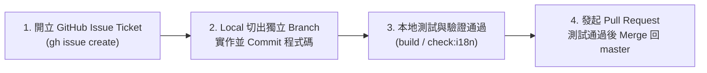

# AGENTS.md — AI Agent Development Guidelines (`stupa-game`)

本文件定義 AI Coding Agent 在 `stupa-game` 專案中開發新功能（Feature）、重構或修復問題時的**強制標準工作流程（Standard Workflow）**與架構規範。所有 Agent 皆須嚴格遵守。

---

## 🔄 標準開發流程（Mandatory Feature & Fix Workflow）

任何新功能（Feature）或重要修改**嚴禁直接在 `master` 主線提交或累積未追蹤變更**，必須嚴格依照以下 4 個步驟執行：



### Step 1：開立 GitHub Issue Ticket (`開 issue ticket`)
- 在動工寫 code 之前，先透過 GitHub CLI 建立對應的 Issue Ticket（若已有對應 Issue 則直接引用該 `#<issue-number>`）：
  ```bash
  gh issue create --title "feat(<scope>): <簡明標題>" --body "<目標、範圍規格與驗收條件>"
  ```
- 若為大型 Epic，應先建立 Epic Issue，再拆分為可獨立交付的子 Issue Tickets，逐一對應獨立的 Branch 與 PR。

### Step 2：本地建立分支並提交程式碼 (`local create branch and commit code`)
- 確保本地 `master` 為最新狀態，並根據 Issue 編號建立語意化分支（例如 `feat/<issue-id>-<short-slug>` 或 `fix/<issue-id>-<short-slug>`）：
  ```bash
  git checkout master && git pull origin master
  git checkout -b feat/<issue-id>-<slug>
  ```
- 在該分支完成功能實作，保持單一職責（Single Responsibility），使用 Conventional Commits 格式提交並附帶 Issue 編號：
  ```bash
  git add <files>
  git commit -m "feat(<scope>): <description> (#<issue-id>)"
  ```
- **注意**：除非使用者明確要求，**切勿 commit `specification_documents` 目錄**。

### Step 3：執行本地建置與自動化驗證 (`測試驗證`)
- 在發 PR 前（以及除錯時），**必須先執行 Build 與相關檢查腳本**，確認零錯誤：
  ```bash
  npm run build
  npm run check:i18n
  ```
- 如涉及圖鑑外部連結或戰鬥數值曲線調整，一併執行：
  ```bash
  npm run check:links
  node scripts/balance-report.mjs
  ```

### Step 4：發起 Pull Request 並於測試通過後合併回主線 (`開 PR 測試通過後 merge master`)
- 將分支推送至遠端並建立 Pull Request（於內文標註 `Closes #<issue-id>`）：
  ```bash
  git push -u origin feat/<issue-id>-<slug>
  gh pr create --base master --head feat/<issue-id>-<slug> \
    --title "feat(<scope>): <標題> (#<issue-id>)" \
    --body "## Summary\n- ...\n\nCloses #<issue-id>"
  ```
- 確認建置與驗收條件全數通過後，將 PR Merge 回 `master` 主線，並切回 `master` 同步最新狀態：
  ```bash
  gh pr merge --merge --delete-branch=false
  git checkout master && git pull origin master
  ```

---

## 🏛️ 核心架構與品質守則（詳見 `ARCHITECTURE.md`）

1. **雙語字典同步 (`src/i18n/*.js`)**：
   - 所有新增 UI、對話、提示（Toast）字串皆須同時註冊 `zh-Hant` 與 `en`，並確保 `npm run check:i18n` 100% 通過。
2. **存檔系統規範 (`src/systems/save.js`)**：
   - 遊戲狀態持久化必須統一透過 `ctx.save`（`stupa.save.v2`）讀寫，禁止在系統模組中直接散落未受控的 `localStorage` 存取。
3. **3D 效能與光源預算 (`PointLight Budget`)**：
   - 全域活躍 `PointLight` 總數上限 $\le 6$（博達哈佛塔區酥油燈台使用 3 盞）。所有章節原野、寺院、秘境、NPC、隊友與個人佛塔皆須維持 **0 新增 `PointLight`**，改以 `emissive` 材質、共享 Geometry 或 `THREE.InstancedMesh` 呈現發光與重複物件。
4. **架構文件同步 (`ARCHITECTURE.md`)**：
   - 若新增模組、公開 `ctx.<module>` API、Event Bus 事件或存檔區塊，應於同一 PR 中同步更新 `ARCHITECTURE.md`。
