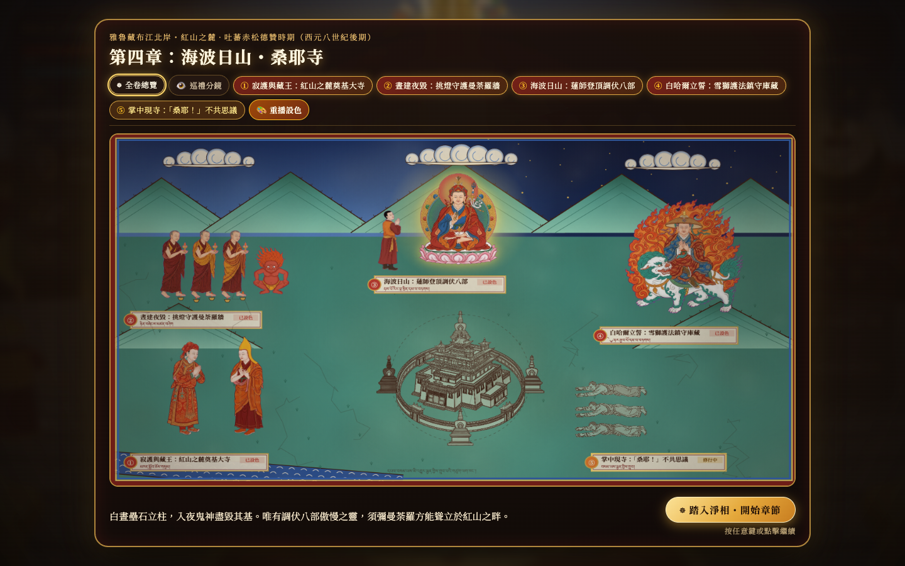
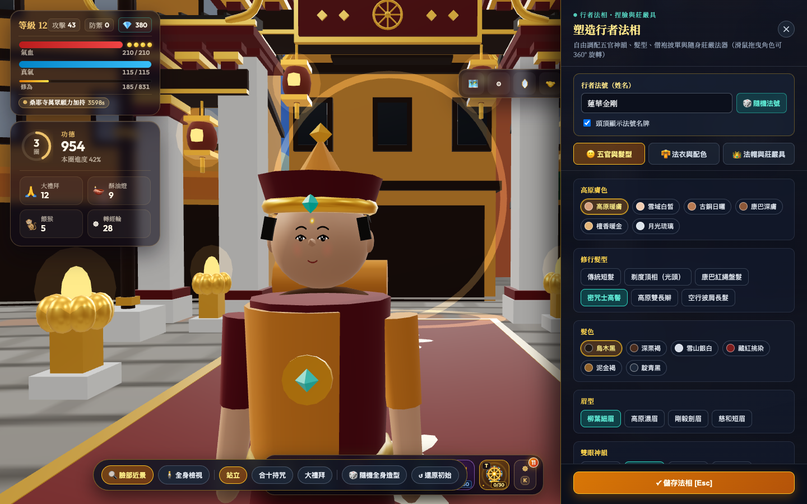

# 博達哈大佛塔・朝聖之旅 ×《蓮師足跡》 | Boudhanath Stupa Pilgrimage 3D: Footsteps of Padmasambhava

[](https://threejs.org/)
[](https://vitejs.dev/)
[](LICENSE)

在瀏覽器中探索全程序化建構的 3D 喜馬拉雅朝聖世界與暗黑式（Diablo-style ARPG）修持冒險。於加德滿都**博達哈大佛塔（Boudhanath Stupa）**順時針繞塔、行五體投地大禮拜、點亮酥油燈、布施獼猴；或是許下滿願大誓，追隨西元八世紀**蓮花生大士（Padmasambhava / Guru Rinpoche）**由尼泊爾入藏弘法的歷史足跡——走過**帕平揚列雪岩洞**、**芒域喜馬拉雅風口**、**雅隆河谷水晶洞**、**海波日山與桑耶寺三樣曼荼羅**，最終抵達**青朴修行地**與無限重玩的**伏藏秘境（Terma Realm）**。

A zero-asset procedural 3D pilgrimage and Diablo-style action RPG in the browser. Circumambulate (*kora*) around Kathmandu's **Boudhanath Stupa**, offer full prostrations, light butter lamps, and feed macaques—or embark on the **Footsteps of Padmasambhava** campaign across 8 interconnected maps from Nepal to Central Tibet (**Pharping Yangleshö**, **Mangyul Pass**, **Yarlung Valley**, **Mount Hepo Ri & Samye Monastery**, **Chimphu Hermitage**, and the procedural **Terma Realm Dungeon**). Instead of bloodshed, obstacles and wrathful spirits are purified into five-color rainbow light (**Liberation / 超度**) or bound by oath as **Dharma Protectors (護法)**.


## 📸 遊戲畫面 / Screenshots

| 黃昏點燈與五體投地禮拜 / Dusk Butter Lamps & Prostration | 雪域荒野與金剛道友除障 / Highland Wilderness & Mantra Co-op |
| :---: | :---: |
|  |  |
| 暮色中點亮環塔祈願酥油燈，於佛塔前行五體投地大禮拜 | 踏入北方雪域荒野，與同行道友誦念「唵嘛呢叭咪吽」綻放金蓮咒輪超度魔障 |

| 桑耶寺三樣曼荼羅落成 / Samye Three-Tiered Mandala | 白哈爾三面六臂調伏戰 / Pehar Multi-Phase Boss Battle |
| :---: | :---: |
|  |  |
| 第四章：烏孜大殿、四色佛塔與 1,008 座圍牆小塔組成的立體曼荼羅 | 迎戰桑耶護庫主白哈爾王，施展蓮花生護輪並召喚誓言護法助陣 |

| 藏傳寺院壁畫長卷・白描與礦物設色 / Tibetan Mural Story Scrolls | 法相工坊・3D 行者五官與法衣自訂 / Pilgrim Appearance Studio |
| :---: | :---: |
|  |  |
| 6 章 22 幕青綠山水寺院壁畫長卷，隨任務圓滿由「白描粉本」逐段渲染為金碧重彩 | 即時 3D 特寫預覽，自由搭配行者法號、五官髮型、藏袍披單、班智達法帽與隨身聖物 |

| 8 欄法器行囊與 12 件伏藏傳奇比較 / 8-Slot Inventory & Terma Legendaries | 四分頁世界輿圖與 38 則法教圖鑑 / 4-Tab World Map & Dharma Codex |
| :---: | :---: |
|  |  |
| 暗黑式詞綴裝備與「伏藏（Terma）」橘裝獨特被動特效、即時戰力對比 | 整合區域地圖、世界輿圖、壁畫長卷與 38 則嚴格區分〔史實〕／〔傳說〕之考據圖鑑 |

---

## 🎮 控制方式 / Controls

### 1. 電腦鍵盤與滑鼠 / Desktop (Keyboard & Mouse)

| 動作 / Action | 按鍵 / Key | 說明 / Description |
|---|---|---|
| **移動 / Move** | `W / A / S / D` 或 方向鍵 | 步行探索佛塔廣場、祈願塔林、各章節地圖與伏藏秘境 |
| **奔跑 / Run** | `Shift` | 疾跑衝刺 |
| **吽字光彈 / Hum Bolt** | `Space` | 發射金色「ཧཱུྃ」光彈（零耗藍、柔性鎖定、命中回藍 +3 MP；對話中可推進台詞） |
| **六字大明咒 / Chant** | `R` | 誦念唵嘛呢叭咪吽，綻放金色蓮花咒輪，超度魔障並抵消敵方法術飛行物 |
| **密法技能 1–4 / Skills 1–4** | `1 / 2 / 3 / 4` | `1` 普巴金剛橛、`2` 蓮花生護輪、`3` 金剛鈴杵、`4` 護法召喚（對話中按 `1–3` 可選擇對話選項） |
| **蓮師心咒大招 / Ultimate** | `T` | 充能滿 30 點時施放十二字蓮師心咒，化現虹光清場並賦予無敵 |
| **甘露水 / Amrita Potion** | `X` | 飲用甘露水立即回復 35% HP + 25% MP（上限 4 瓶，超度精英或轉經補充） |
| **回城 / Recall** | `B` | 引導 2.5 秒開啟雙向蓮花傳送門返回博達哈大佛塔（受擊中斷） |
| **大禮拜 / Prostrate** | `Q` | 於佛塔廣場與塔林行五體投地禮拜，累積功德並恢復氣血（HP） |
| **互動・點燈・對話 / Interact** | `E` 或 `Enter` | 與 NPC 交談、點亮酥油燈、轉動經輪、開啟法界道標與伏藏寶篋、穿梭山門 |
| **餵食猴子 / Feed** | `F` | 布施香蕉給獼猴，恢復真氣並有機率獲贈神聖法器 |
| **正面法相視角 / Front Portrait View** | `V` | 切換正面特寫鏡頭檢視行者五官、法衣與莊嚴具，並可一鍵開啟「🪞 法相工坊」 |
| **行囊背包 / Inventory** | `I` | 開啟 8 欄護身法器裝備、30 格行囊面板與法相自訂捷徑 |
| **修行法相 / Character** | `C` | 檢視詳細屬性（攻防、暴擊、降魔、減冷卻、尋寶）與已啟用伏藏密意 |
| **密法修持面板 / Skills** | `K` | 分配技能點（Rank 1–5）、選擇 Rank 3 A/B 專精分支與切換出戰護法 |
| **朝聖日誌 / Quest Journal** | `J` | 檢視當前追蹤任務、已完成任務、章節壁畫畫卷與重播設色 |
| **世界輿圖・圖鑑・壁畫 / Map, Codex & Murals** | `M` | 開啟 4 合 1 面板：**🗺️ 區域地圖**、**🏔️ 世界輿圖（道標傳送）**、**📜 法教圖鑑（38 則）**、**🎨 壁畫長卷收藏館** |
| **供燈祈願・鏡頭跟隨 / Lamp Wall & Camera Follow** | `L` / `Alt + C` | 按 `L` 開啟「🪔 供燈祈願與十方祈願燈海」；移動時按 `L` 或 `Alt + C` 可切換鏡頭自動跟隨／自由視角 |
| **小地圖縮放與拖曳 / Minimap Zoom & Drag** | `Tab` / 滑鼠拖曳 | 按 `Tab` 切換右上角雷達小地圖視野（`45m` / `90m`）；可直接用滑鼠拖曳小地圖調整螢幕位置 |
| **顯示地面掉落物 / Show Loot** | `Alt`（按住） | 強制顯示地面所有戰利品名牌與稀有度光柱 |
| **轉動視角 / Look** | 滑鼠左鍵/右鍵拖曳 | 360 度環視場景 |
| **鏡頭縮放 / Zoom** | 滑鼠滾輪 | 縮放第三人稱視角距離 |
| **暫停時間 / Pause** | `P` | 暫停日夜光影流動 |
| **隱藏介面 / HUD** | `H` | 隱藏或顯示遊戲介面，便於沉浸截圖 |
| **關閉視窗 / Close Modal** | `Esc` | 關閉當前開啟之任何面板、對話或壁畫長卷 |

### 2. 右上角快捷工具列 / Top-Right Utility Bar

畫面右上角工具列（手機版可點選 `⋯` 展開）整合了所有核心修持、社群共修與系統設定功能：

- **`⚙` 遊戲設定與存檔備份（Settings & Save Backup）**：
  - **戰鬥難度**：隨時切換 **故事模式（Story）**、**標準模式（Standard）**、**金剛試煉（Vajra Trial）**。
  - **鏡頭自動跟隨**：切換 **智慧跟隨（Smart）**、**自由視角（Off）**、**持續鎖定（On）**。
  - **六字大明咒音色**：切換 **自然女聲吟唱（Natural Voice）** 與 **器樂梵音（Instrumental）**。
  - **模式切換**：於《蓮師足跡》ARPG、《鏡中之人》敘事章節與雙模式主選單之間安全切換（自動保存進度）。
  - **存檔備份與還原**：一鍵將完整遊戲進度（`stupa.save.v2`）下載為 `.json` 備份檔，或匯入備份檔跨裝置還原。
- **`🪞` 法相工坊（Appearance Studio）**：隨時自訂行者法號（含隨機法號與頭頂名牌開關）、五官與髮型（膚色、眼型、瞳色、眉型、額間白毫／朱砂印）、法衣與背光配色、法帽與莊嚴具（念珠、嘎烏盒、轉經輪、經篋、背負普巴杵），支援 3D 舞台 360° 拖曳旋轉與動作預覽。
- **`🗺️` 世界輿圖・法教圖鑑・壁畫長卷（`M`）**：一鍵開啟區域雷達圖、全境路線圖、38 則法教圖鑑與 6 章壁畫長卷收藏館。
- **`🎒` 行囊與法相（`I` / `C`）**：管理 8 欄護身法器、30 格行囊、一鍵整理與詳細角色屬性。
- **`🪔` 供燈祈願與十方祈願燈海（`L`）**：點亮酥油燈並題寫祈願迴向文（5 大祈願主題與經典迴向詞），瀏覽「十方祈願燈海」、隨喜添油延長燈火（+120 秒），並支援離線結緣碼（`STUPA-V1:...`）匯出與匯入。
- **`🏛️` 個人祈願佛塔營造與桑耶千塔共願（Stupa Builder & Samye 1,008 Co-op）**：
  - **個人祈願佛塔**：以繞塔與大禮拜功德解鎖基座、塔身、十三天相輪與塔頂莊嚴材質（支援「⚡ 淨相預覽模式」），立塔銘刻後安奉於佛塔南門外的 **「祈願塔林（Pilgrim Stupa Grove）」**。
  - **桑耶千塔共願**：奉獻功德（`108 功德 = +1 座小舍利塔`）參與桑耶寺圍牆 1,008 座小塔全服共建，解鎖四階段護摩加持增益。
- **`🤝` 金剛道友連線共修大廳（Vajra Sangha Co-op Lobby）**：檢視即時同域人數與分流（如 `stupa#1`）、建立或加入 4 人公開／私密共修房間、一鍵召喚 **AI 同行道友幻身** 協同作戰（分擔仇恨、施放真言共鳴、倒地救援），以及發送 4 種法教表情氣泡（`🙏 頂禮`、`☸ 誦咒`、`🪔 供燈`、`⚔️ 護法`）。
- **`EN / 中`・`🔊`・`🎵`・`?`・`🔑`・`👁`**：雙語即時切換、音效靜音、動態配樂開關、朝聖指南與成就列表、密續除錯與章節跳關面板（解鎖密語 `amitabha`）、隱藏 HUD（`H`）。

### 3. 手機與觸控螢幕 / Mobile & Touch

- **虛擬搖桿 / Virtual Joystick**：觸摸螢幕左半側即可控制移動（半徑 `60px`），推至外圈自動奔跑；放開後保留半透明基準環提示。
- **視角滑動與防誤觸縮放 / Camera Pan & Safari Zoom Guard**：在螢幕右側空白區域滑動以旋轉鏡頭；內建 iOS Safari 雙指與連點防縮放保護，雙拇指高速戰鬥不誤觸頁面縮放。
- **可收合面板與精簡工具列 / Collapsible HUD Panels**：左上角功德面板、右上角時辰滑桿與 `⋯` 快捷工具列皆支援點擊展開／收合，最大化手機視野。
- **右下弧形技能盤 / Ergonomic Arc Skill Pad**：
  - **主拇指大鍵**：`Space` 吽字光彈（68px），外環圍繞 `R` 六字大明咒與 `1 / 2 / 3 / 4 / T` 弧形技能鍵。
  - **快捷輔助鍵**：甘露水 `X`（附剩餘瓶數徽章）、回城 `B`、以及動態高亮互動鍵 `E`（靠近 NPC、燈台、法界道標或山門時自動脈動放大）。
- **觸控友善行囊、商販與對話**：點擊背包、裝備格、行腳商販或隨寺工匠項目可直接操作或展開底部大型操作列（`裝備 / 卸下 / 供養 / 拆解 / 丟棄 / 關閉`），無需雙擊或右鍵；所有對話選項與按鈕皆符合 `>= 40×40 px` 觸控規範。

---

## 🏔️ 遊戲特色與《蓮師足跡》系統總覽 / Gameplay & Campaign Systems

### 1. 佛塔修持與祈願塔林 / Stupa Practices & Pilgrim Stupa Grove (Hubs)
- **繞塔（Kora）**：沿順時針方向環繞大佛塔（塔在右肩），每繞滿一圈可累積 108 點功德；與線上或 AI 同行道友並肩繞塔可觸發「共修繞塔功德加成」。
- **大禮拜（Prostration）**：合十並全身伏地禮拜，淨化身語意，每次恢復 25 點氣血（HP）。
- **酥油燈台與祈願燈海（Butter Lamps & Lamp Wall）**：走近 3 座環形石雕燈台點亮酥油燈，照亮夜空並每次恢復 15 點真氣（MP），還可留下祈願銘文供十方行者隨喜添油。
- **猴群布施與神聖加持（Monkeys & Sacred Blessings）**：靠近漫步的獼猴按 `F` 投餵香蕉，有機率獲贈加持繩（Sungdu）、法螺（Dungkar）、嘎烏盒（Gau）、金剛杵（Dorje）。
- **行腳商販與隨寺工匠（Merchant & Artisan）**：於佛塔廣場使用綠松石（Turquoise）請購裝備、拆解多餘法器獲取「碎綠松石 / 金粉 / 伏藏精華」，並進行詞綴**重鑄（Reforge）**與品質**灌頂升階（Consecrate）**。
- **南門外苑・祈願塔林（Pilgrim Stupa Grove）**：穿過佛塔廣場南門即可步入寧靜的「祈願塔林」，瞻禮自己與十方行者親手營造的 3D 祈願佛塔，行大禮拜或隨喜讚歎。

### 2. 《蓮師足跡》六大章節與 9 大探索地圖 / 6 Story Chapters & 9 Maps
| 章節 / Chapter | 地圖 ID | 聖地名稱 / Region | 建議等級 | 特色機制與章節頭目 / Key Mechanics & Boss |
|---|---|---|---|---|
| **序章 / Prologue** | `stupa`, `grove`, `wild` | 博達哈大佛塔・祈願塔林・北郊原野<br>Boudhanath, Stupa Grove & Wilds | Lv 1–6 | 滿願塔誓願、南門祈願塔林立塔、三大基礎魔障（餓鬼、贊魔、雪人）、首領**雪山巨魔（Migoi King）** |
| **第一章 / Ch.1** | `pharping` | 帕平・揚列雪與阿修羅洞<br>Pharping & Yangleshö Cave | Lv 5–10 | 旱災火患轉化甘霖綠谷、雙修岩洞點燈、調伏**旱災那伽王（Drought Naga Lord）**，習得**普巴金剛橛** |
| **第二章 / Ch.2** | `mangyul` | 芒域山口・喜馬拉雅風口<br>Mangyul Pass | Lv 10–16 | 暴風雪陣風推力與避風石堆、護送梵夾信使、調伏**丹瑪暴雪化現（Tenma Storm）**，習得**金剛鈴杵**並收服**丹瑪十二女** |
| **第三章 / Ch.3** | `yarlung` | 雅隆河谷・雍布拉康與水晶洞<br>Yarlung Valley & Sheldrak | Lv 16–23 | 偽裝岩石年神、以金剛鈴聲安撫狂暴野犛牛、調伏**雅拉香波山神（Yarlha Shampo）**，習得**蓮花生護輪**並收服**白犛牛護法** |
| **第四章 / Ch.4** | `samye` | 海波日山・桑耶寺三樣曼荼羅<br>Mount Hepo Ri & Samye | Lv 23–30 | 桑耶寺 5 階段動態興建（1,008 座圍牆小塔 InstancedMesh）、晝建夜毀守城戰、海波日山四波調伏戰、調伏**白哈爾王（Pehar）**，習得**蓮師心咒大招** |
| **終章 / Finale** | `chimphu`, `terma` | 青朴修行地・伏藏秘境<br>Chimphu & Terma Realm | Lv 30–40 | 益西措嘉空行母封存伏藏、無限種子生成之 **3 層式伏藏秘境（Tier 1–10）** 與終局頭目**伏藏護法主（Terma Guardian）** |

### 3. 七大密法技能與三階 A/B 專精 / 7 Dharma Skills & Rank 3 Mastery
1. **吽字光彈（`Space` / `humBolt`）**：零耗藍基礎遠程光彈，命中回復 3 MP；Rank 3 可選 **A 三連發散射** 或 **B 貫穿減速**。
2. **六字大明咒（`R` / `mantra`）**：6m 金蓮咒輪 AoE 並擊碎敵方魔法投射物；Rank 3 可選 **A 咒輪擴展 + 擊退** 或 **B 甘露迴向（每命中 1 敵回 3 HP）**。
3. **普巴金剛橛（`1` / `phurba`）**：投擲三稜金剛橛造成高倍率穿刺與 2 秒定身（Root）；Rank 3 可選 **A 貫穿直線並留金剛火徑** 或 **B 破障爆發（對護盾/精英 +60% 傷害）**。
4. **蓮花生護輪（`2` / `lotusShield`）**：展開八瓣紅白蓮花護盾吸收 40% 最大氣血傷害；Rank 3 可選 **A 蓮華反震（破盾時震暈周圍敵人）** 或 **B 甘露蓮華（護盾期間每秒回血並解緩速）**。
5. **金剛鈴杵（`3` / `vajraBell`）**：扇形音波震懾眩暈 2.5 秒並瞬間擊碎敵方無敵護盾，同時可安撫暴走靈獸；Rank 3 可選 **A 空性迴響（易傷 +25%）** 或 **B 雙運雷音（360° 全周音波）**。
6. **護法召喚（`4` / `protector`）**：召喚已立誓之護法（**丹瑪十二女**冰晶齊射、**雅拉香波白犛牛**衝鋒嘲諷、**白哈爾**三面六臂旋風斬）助陣 15 秒。
7. **蓮師心咒大招（`T` / `vajraGuru`）**：誦念十二字心咒 `ཨོཾ་ཨཱཿཧཱུྃ་བཛྲ་གུ་རུ་པདྨ་སིདྡྷི་ཧཱུྃ`，全屏五色虹光傾瀉 3 秒並獲得金剛無敵。

### 4. 暗黑式法器戰利品、伏藏岩洞與 12 件伏藏傳奇 / Loot, Terma Caves & 12 Terma Legendaries
- **8 個裝備欄位**：主手法器、副手、法帽、法衣、護腕、藏靴、念珠、戒指。
- **4 階稀有度**：白（凡品）、藍（加持，1–2 詞綴）、金（殊勝，3–4 詞綴）、橘（**伏藏 Terma**，固定基底 + 3 詞綴 + 專屬傳奇被動 `powerId`）。
- **12 件伏藏傳奇特效（Terma Powers）**：
  - `蓮師金剛橛 (phurbaSplit)`：普巴橛分裂為 3 支扇形射出並額外定身 +1 秒。
  - `蓮師天鐵九股杵 (thokchaVajra)`：施放六字真言時降下 6.5m 天鐵雷霆，造成 110% ATK 法術傷害並震懾 1.5 秒。
  - `靜命論師金剛鈴 (bellReset)`：金剛鈴命中或驅散 3 個以上目標時，重置六字真言冷卻並回復 15 MP。
  - `空行母秘密明鏡 (dakiniMirror)`：生命低於 30% 時化為五色虹光免疫傷害 2.5 秒並回復 40% 最大生命。
  - `烏金蓮花法帽 (uddiyanaLotusHat)`：技能冷卻縮減額外 +10%，且蓮師心咒大招所需充能減少 5 點。
  - `桑耶鎮寺法輪 (samyeMandala)`：每第 3 次施放六字真言觸發 9m 桑耶金剛壇城（ATK × 1.8）。
  - `青朴靜慮念珠 (chimphuStill)`：靜止 1.5 秒進入「止觀」（技能傷害 +25%、每秒 +5 MP）。
  - `丹瑪護法天衣 (tenmaOath)`：生命低於 35% 時自動召喚丹瑪女神 10 秒並獲得 25% 護盾。
  - `雪山白犛之角 (yakFrost)`：施放六字真言在地面留下 4m 寒霜領域 4 秒（緩速 40% 並持續傷害）。
  - **秘境專屬（Tier 3+）**：`措嘉的空行念珠 (tsogyalMemory)`、`伏藏師之戒 (tertonFind)`、`青朴閉關法衣 (retreatShield)`。
- **五大章節伏藏岩洞（Terma Caves）**：第一章至第五章荒野皆藏有隱秘伏藏窟，通過護法試煉開啟伏藏寶篋，可迎請**五色黃紙伏藏卷（Shogser Scrolls）**與**甘露法藥丸（Mendrup Pills）**永久提升基礎屬性，集齊後更可獲得**掘藏師羅盤**與**大圓滿灌頂加持**。

### 5. 日夜流轉與程序化動態配樂 / Atmosphere & Adaptive Score
- **動態天色與零外部音檔 Web Audio 合成**：黎明、正午、黃昏、星夜與經幡隨風飄揚；西藏頌缽、銅鈴、轉經輪、「唵」字 108 Hz 共鳴墊、自然女聲六字大明咒吟唱與高原雄鷹長唳皆由 Web Audio API 即時合成。
- **程序化動態配樂（Adaptive Score）**：
  - 以合成的林布竹笛、札木聶琴、坦普拉、頌缽、叮夏、大鼓、達瑪如、塔布拉、羅爾莫鈸、銅欽長號、甲林嗩吶與僧眾低音誦經演奏，A4 = 432 Hz 與「唵」字泛音同調。
  - 貫穿全劇的「蓮師心咒動機」（十二字心咒旋律）與序章「誓願動機」；各章節依劇情推進切換變奏（帕平旱災 → 甘霖、芒域暴雪 → 風馬、雅隆暴走 → 牧歌、桑耶晝建夜毀 → 落成）。
  - 頭目戰為羌姆金剛舞，隨階段加速加層；章節開場、圓滿、調伏與蓮師現身皆有專屬樂句。
  - HUD 🎵 按鈕可單獨開關配樂；開發模式下可於 `/music-lab.html` 試聽全部曲目。

### 6. 藏傳寺院壁畫關卡劇情圖說 / Tibetan Temple Mural Story Scrolls
- **離線礦物彩繪點陣圖 × 程序化青綠山水長卷**：
  - 內建 20 張手工繪製風格之藏傳壁畫去背元件（蓮師雙身相、金剛亥母、普巴金剛橛、黑蛇那伽王、赤松德贊與寂護大師、白哈爾護法、桑耶曼荼羅、博達哈大佛塔、雍布拉康、益西措嘉等），搭配程序化繪製的石綠／青金石山巒、浪花渦卷暗河、藏式如意雲頭與金箔泥金榜題框。
  - **自動「白描粉本（Pounce Sketch）」提取**：瀏覽器載入彩色點陣圖後，自動透過 Sobel 邊緣梯度與赭石墨線演算法即時生成單色「白描粉本」圖層。
- **章節開場畫卷（Chapter Intro Scroll）**：
  - 踏入新章節時展開整幅寺院壁畫長卷，未完成之劇情段落以「白描粉本」呈現，已完成段落則綻放礦物彩繪與金箔光澤，並支援自動橫移導覽（Pan Tour）與點擊分鏡聚焦。
- **完成任務・逐段設色（Wet-Brush Coloring Reveal）**：
  - 每當完成一個主線任務（全劇共 6 章、22 個分鏡段落），任務圓滿橫幅會將鏡頭聚焦至該劇情壁畫分鏡，以不規則水彩筆觸遮罩（Wet-Brush Radial Mask）伴隨灑金粒子，將白描底稿現場渲染為全彩金碧壁畫。
- **壁畫長卷收藏館（Mural Scrolls Gallery）**：
  - 可隨時於 `M` 世界輿圖的 **「壁畫長卷（Mural Scrolls）」** 分頁、世界路線圖節點、或 `J` 朝聖日誌中展開各章全幅畫卷，並任意點選已完成分鏡重播「白描 → 礦物設色」動畫。

---

## 📚 史實與傳說考據 / Historical & Cultural Sources

遊戲內建 **38 則法教圖鑑（Dharma Codex）**，每則條目皆明確區分 **〔史實〕** 與 **〔傳說〕** 並附有 Wikipedia、UNESCO、The Treasury of Lives、Rigpa Wiki、84000 等外部學術與百科連結。完整條目內容與 59 條考據文獻清單請參閱：
👉 **[`docs/padmasambhava-sources.md`](./docs/padmasambhava-sources.md)**

---

## 🛠️ 開發、檢查與建置 / Development & Verification

本專案完全基於標準 ES 模組與 Vite，無任何外部 3D 模型或音訊檔案：

```bash
# 安裝相依套件
npm install

# 啟動本地開發伺服器（加 ?debug=1 可啟用 window.__stupa 除錯 API）
npm run dev

# 執行雙語 i18n 完整性檢查（驗證 zh-Hant 與 en 共 2,781 個鍵值對稱且無缺漏）
npm run check:i18n

# 執行法教圖鑑外部文獻連結有效性檢查（驗證 38 則圖鑑共 59 條 URL）
npm run check:links

# 執行全等級 (Lv 1–40) 戰鬥數值、TTK 與經濟模擬報表
node scripts/balance-report.mjs

# 專案打包建置（生成 dist/ 靜態資源，含自動 code-splitting）
npm run build

# 本地預覽建置成果
npm run preview
```

## 📜 架構規範 / Architecture Highlights

詳細架構設計、狀態機、事件匯流排、資料表 Schema 與「如何新增一個章節」開發指南請參閱 **[`ARCHITECTURE.md`](./ARCHITECTURE.md)**。
- **零 Magic Number**：所有數值統一收斂於 `src/config.js` 與 `src/data/**`。
- **完全國際化**：繁體中文與英文雙語即時切換（`src/i18n.js` + `npm run check:i18n` CI 自動驗證）。
- **效能預算與無縫分塊**：保持 60 FPS，全場景動態 PointLight $\le 6$（原野與章節地圖為 0 PointLight），所有章節地圖動態 `import()` 延遲載入，Draw Calls $< 400$。

## 《鏡中之人》敘事 Demo / The Person in the Mirror

The root URL opens the original **Footsteps adventure** by default. The explicit
`/?mode=home` menu also offers an independent
**Mirror narrative journey**. Existing ARPG saves remain in their original
sections; narrative progress is autosaved in its own `story` section.

- Open `/?mode=story` for the approximately 15-minute reading/exploration slice.
- Open `/?mode=adventure` for the original ARPG, historical maps and multiplayer.
- Walk with WASD/arrows; drag or use IJKL to look; E to interact. On touch screens,
  drag the left side to walk and the right side to look.
- The visible clue-assist button and camera-assist control support players who
  prefer accessible navigation. Open the phone to revisit unlocked records.
- Settings offer Cinematic/Legacy, dawn/day/dusk, low/high quality, language,
  ambience, documentary replay and story-only restart.
- Prologue → Boudha exploration → photo alignment → restoration documentary →
  Losang's map → a brief Pharping vision → a new diary. No combat or leveling.

Both the novel and plan were read for this implementation. Still images are
clearly labeled illustrative reconstructions, not archival photos. The digital
proxy uses fixed authored dialogue and is explicitly **not Yingzhen herself**.
The optional chapter continuation now includes Pharping, Mangyul, Yarlung, Samye,
Chimphu and a fixed-script letter/finale. These are compact exploration adaptations,
with reviewed text fallbacks; final media polish is tracked separately.

Run `npm test` for regressions. For browser acceptance, start `npm run dev -- --host
127.0.0.1 --port 4173`, install Playwright Chromium (`npx playwright install
chromium`), then `npm run test:browser`. Set `BROWSER_CHANNEL=chrome` to use an
installed Chrome. See [contracts](docs/story/contracts.md),
[validation](docs/story/validation.md), and [asset provenance](public/story/manifest.json).

### 後續敘事章節試玩 / Narrative chapter preview

完成 Demo 後開啟右上角「旅程與聖地」，從帕平依序探索到終章。每一步自動保存；完成一章即可選下一章，離開後可重訪而不改原進度。聖地頁沿用原圖鑑正文與來源。

兩種模式均有「切換模式」按鈕，可切到章節、原 ARPG 或主選單。切換前會保存；寫入失敗會留在原頁並提示。原戰鬥、技能、裝備、Boss、多人與歷史地圖保留。

[章節契約](docs/story/chapter-roadmap.md) · [驗證範圍](docs/story/chapter-validation.md) · Issues #91–#98。此分支供驗收，未合併 master。

在故事設定的「章節測試工具」輸入 `amitabha`，可選任意章節與檢查點。
「開始試玩」只改暫存測試狀態，退出後回到原進度；結局分支需明確選擇。
原 Demo 另有清楚警告、需確認的正式進度跳轉，與安全章節試玩分開。

修復歷史已接入核准的四張圖片與三段靜音 360p 影片，可手動下一段、暫停、
重播與拖曳影片進度。降低動態偏好預設顯示靜態圖。到達淨相後可從設定
開啟「泉邊的光影」短片；互動場景本身仍可直接探索。

`STORY_SUITE=journey npm run test:browser` 可從新 Demo 連續操作至六章終局，
不使用 debug 推進。媒體與跳關分別由 `scripts/story-media-browser-test.mjs`、
`scripts/story-debug-browser-test.mjs` 驗證。

### Vercel acceptance preview

Open the deployment root for Adventure. The visible chapter-mode button opens
the guarded mode selector; `/?mode=story` opens chapters directly and
`/?mode=home` retains the dual-mode launcher. Mode switching preserves saved
sections and refuses navigation when a save fails.

Manual dispatch of the Vercel workflow defaults to Preview and supports the
current feature branch. Production deployment remains restricted to master;
this acceptance branch must not be merged automatically. Known Linux headless
CI exceptions remain tracked in #116 and are not waived by a Preview deployment.
