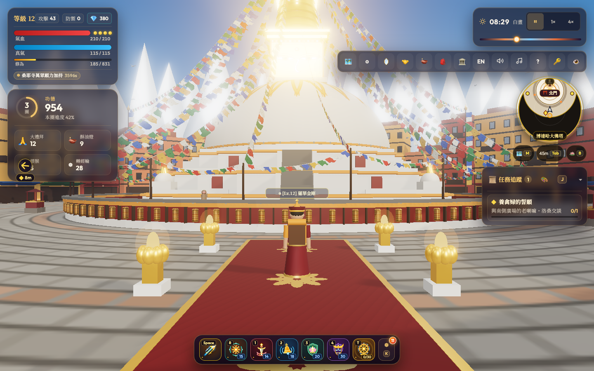
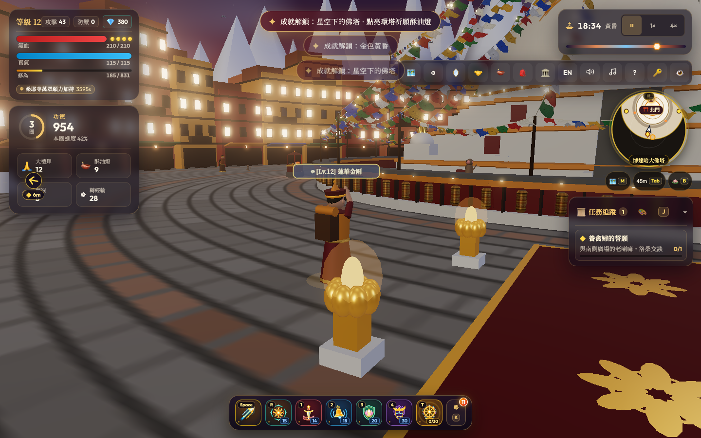
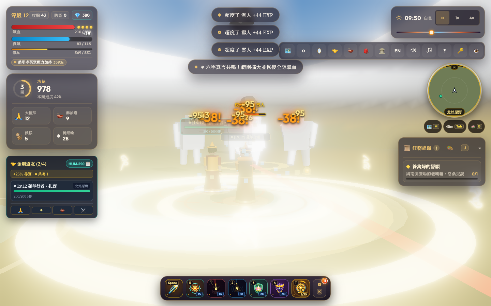
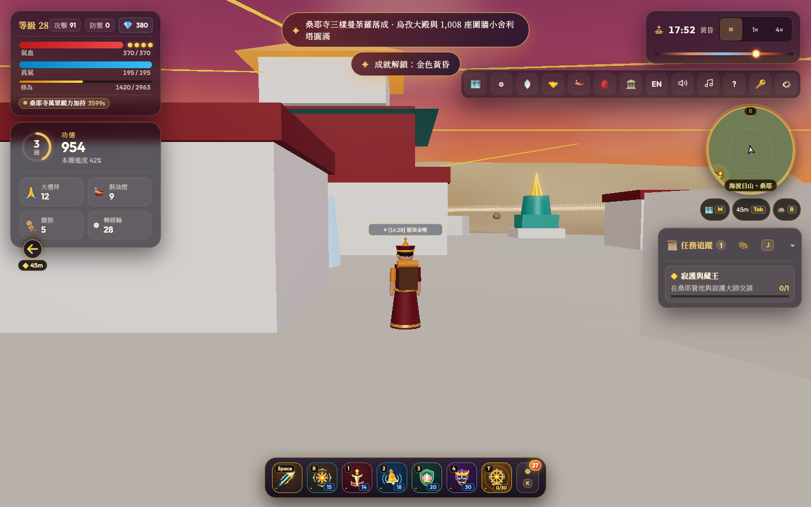
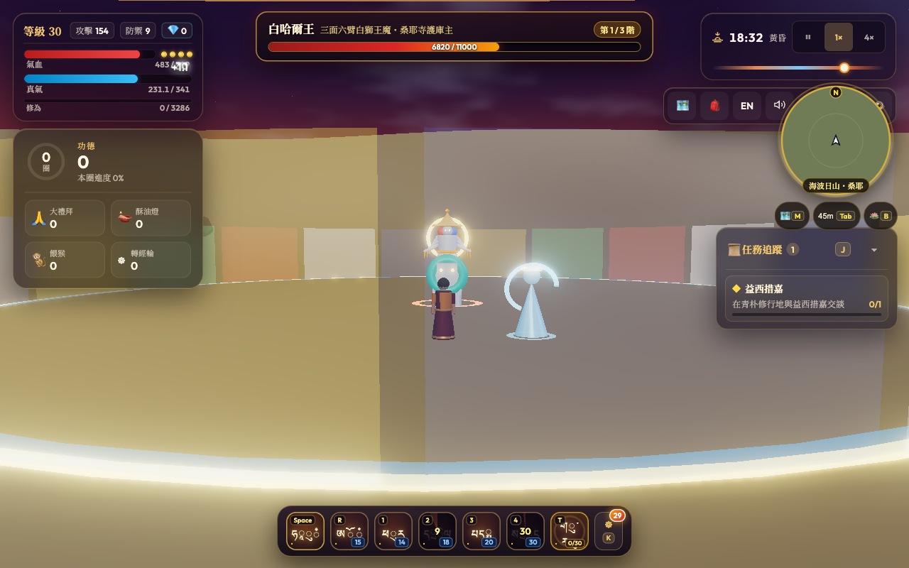
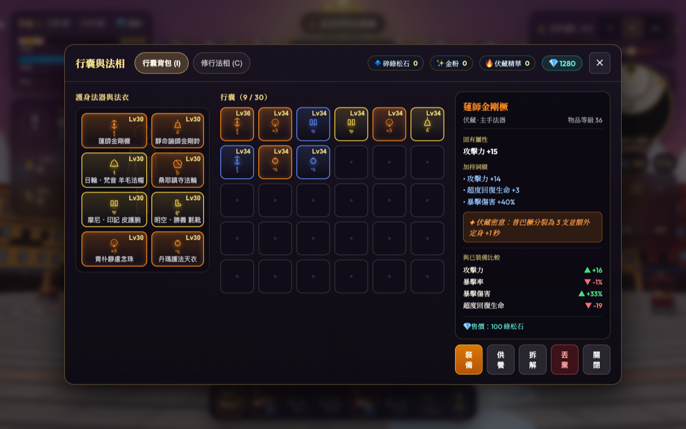
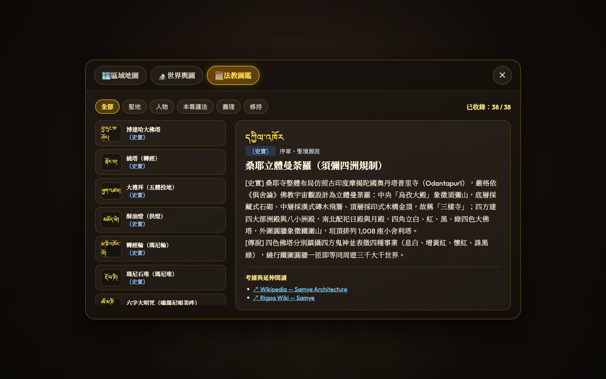

# 博達哈大佛塔・朝聖之旅 ×《蓮師足跡》 | Boudhanath Stupa Pilgrimage 3D: Footsteps of Padmasambhava

[](https://threejs.org/)
[](https://vitejs.dev/)
[](LICENSE)

在瀏覽器中探索全程序化建構的 3D 喜馬拉雅朝聖世界與暗黑式（Diablo-style ARPG）修持冒險。於加德滿都**博達哈大佛塔（Boudhanath Stupa）**順時針繞塔、行五體投地大禮拜、點亮酥油燈、布施獼猴；或是許下滿願大誓，追隨西元八世紀**蓮花生大士（Padmasambhava / Guru Rinpoche）**由尼泊爾入藏弘法的歷史足跡——走過**帕平揚列雪岩洞**、**芒域喜馬拉雅風口**、**雅隆河谷水晶洞**、**海波日山與桑耶寺三樣曼荼羅**，最終抵達**青朴修行地**與無限重玩的**伏藏秘境（Terma Realm）**。

A zero-asset procedural 3D pilgrimage and Diablo-style action RPG in the browser. Circumambulate (*kora*) around Kathmandu's **Boudhanath Stupa**, offer full prostrations, light butter lamps, and feed macaques—or embark on the **Footsteps of Padmasambhava** campaign across 8 interconnected maps from Nepal to Central Tibet (**Pharping Yangleshö**, **Mangyul Pass**, **Yarlung Valley**, **Mount Hepo Ri & Samye Monastery**, **Chimphu Hermitage**, and the procedural **Terma Realm Dungeon**). Instead of bloodshed, obstacles and wrathful spirits are purified into five-color rainbow light (**Liberation / 超度**) or bound by oath as **Dharma Protectors (護法)**.



## 📸 遊戲畫面 / Screenshots

| 黃昏點燈與五體投地禮拜 / Dusk Butter Lamps & Prostration | 雪域荒野與六字大明咒除障 / Highland Wilderness & Mantra Combat |
| :---: | :---: |
|  |  |
| 暮色中點亮環塔酥油燈，於佛塔前行五體投地大禮拜 | 踏入北方雪域荒野，誦念「唵嘛呢叭咪吽」綻放金蓮咒輪超度魔障 |

| 桑耶寺三樣曼荼羅落成 / Samye Three-Tiered Mandala | 白哈爾三面六臂調伏戰 / Pehar Multi-Phase Boss Battle |
| :---: | :---: |
|  |  |
| 第四章：烏孜大殿、四色佛塔與 1,008 座圍牆小塔組成的立體曼荼羅 | 迎戰桑耶護庫主白哈爾王，施展蓮花生護輪並召喚誓言護法助陣 |

| 8 欄法器行囊與伏藏傳奇比較 / 8-Slot Inventory & Terma Legendaries | 法教圖鑑（史實與傳說考據） / Dharma Codex (38 Entries) |
| :---: | :---: |
|  |  |
| 暗黑式詞綴裝備與「伏藏（Terma）」橘裝獨特被動特效、即時戰力對比 | 收錄 38 則聖地、人物、本尊護法、義理與修持考據，嚴格區分〔史實〕與〔傳說〕 |

---

## 🎮 控制方式 / Controls

### 電腦鍵盤與滑鼠 / Desktop (Keyboard & Mouse)

| 動作 / Action | 按鍵 / Key | 說明 / Description |
|---|---|---|
| **移動 / Move** | `W / A / S / D` 或 方向鍵 | 步行探索佛塔廣場、各章節地圖與伏藏秘境 |
| **奔跑 / Run** | `Shift` | 疾跑衝刺 |
| **吽字光彈 / Hum Bolt** | `Space` | 發射金色「ཧཱུྃ」光彈（零耗藍、柔性鎖定、命中回藍 +3 MP） |
| **六字大明咒 / Chant** | `R` | 誦念唵嘛呢叭咪吽，綻放金色蓮花咒輪，超度魔障並抵消敵方法術飛行物 |
| **密法技能 1–4 / Skills 1–4** | `1 / 2 / 3 / 4` | `1` 普巴金剛橛、`2` 蓮花生護輪、`3` 金剛鈴杵、`4` 護法召喚 |
| **蓮師心咒大招 / Ultimate** | `T` | 充能滿 30 點時施放十二字蓮師心咒，化現虹光清場並賦予無敵 |
| **甘露水 / Amrita Potion** | `X` | 飲用甘露水立即回復 35% HP + 25% MP（上限 4 瓶，超度精英或轉經補充） |
| **回城 / Recall** | `B` | 引導 2.5 秒開啟雙向蓮花傳送門返回博達哈大佛塔（受擊中斷） |
| **大禮拜 / Prostrate** | `Q` | 於佛塔廣場行五體投地禮拜，累積功德並恢復氣血（HP） |
| **互動・點燈・對話 / Interact** | `E` 或 `Enter` | 與 NPC 交談、點亮酥油燈、轉動經輪、開啟法界道標、穿梭山門 |
| **餵食猴子 / Feed** | `F` | 布施香蕉給獼猴，恢復真氣並有機率獲贈神聖法器 |
| **行囊背包 / Inventory** | `I` | 開啟 8 欄護身法器裝備與 30 格行囊面板 |
| **修行法相 / Character** | `C` | 檢視詳細屬性（攻防、暴擊、降魔、減冷卻、尋寶）與已啟用伏藏密意 |
| **密法修持面板 / Skills** | `K` | 分配技能點（Rank 1–5）、選擇 Rank 3 A/B 專精分支與切換出戰護法 |
| **朝聖日誌 / Quest Journal** | `J` | 檢視當前追蹤任務、已完成任務、章節壁畫畫卷與重播設色 |
| **世界輿圖・壁畫長卷 / World Map & Murals** | `M` | 開啟《蓮師足跡》全境路線圖、區域地圖、道標傳送與**壁畫長卷收藏館** |
| **法教圖鑑 / Dharma Codex** | `L` | 開啟 38 則藏傳佛教歷史與傳說百科圖鑑 |
| **小地圖縮放 / Minimap Zoom** | `Tab` | 切換右上角雷達小地圖視野（`45m` / `90m`） |
| **顯示地面掉落物 / Show Loot** | `Alt`（按住） | 強制顯示地面所有戰利品名牌與光柱 |
| **轉動視角 / Look** | 滑鼠左鍵/右鍵拖曳 | 360 度環視場景 |
| **鏡頭縮放 / Zoom** | 滑鼠滾輪 | 縮放第三人稱視角距離 |
| **暫停時間 / Pause** | `P` | 暫停日夜光影流動 |
| **隱藏介面 / HUD** | `H` | 隱藏或顯示遊戲介面，便於沉浸截圖 |

### 手機與觸控螢幕 / Mobile & Touch

- **虛擬搖桿 / Virtual Joystick**：觸摸螢幕左半側即可控制移動（半徑 `60px`），推至外圈自動奔跑；放開後保留半透明基準環提示。
- **視角滑動 / Camera Pan**：在螢幕右側空白區域滑動以旋轉鏡頭。
- **右下弧形技能盤 / Ergonomic Arc Skill Pad**：
  - **主拇指大鍵**：`Space` 吽字光彈（68px），外環圍繞 `R` 六字大明咒與 `1 / 2 / 3 / 4 / T` 弧形技能鍵。
  - **快捷輔助鍵**：甘露水 `X`（附剩餘瓶數徽章）、回城 `B`、以及動態高亮互動鍵 `E`（靠近 NPC、燈台、法界道標或山門時自動脈動放大）。
- **觸控友善行囊與對話**：點擊背包或裝備格直接展開底部大型操作列（`裝備 / 卸下 / 供養 / 拆解 / 丟棄 / 關閉`），無需雙擊或右鍵；所有對話選項與按鈕皆符合 `>= 40×40 px` 觸控規範。

---

## 🏔️ 遊戲特色與《蓮師足跡》系統總覽 / Gameplay & Campaign Systems

### 1. 佛塔修持 / Stupa Practices (Hub)
- **繞塔（Kora）**：沿順時針方向環繞大佛塔（塔在右肩），每繞滿一圈可累積 108 點功德。
- **大禮拜（Prostration）**：合十並全身伏地禮拜，淨化身語意，每次恢復 25 點氣血（HP）。
- **酥油燈台（Butter Lamps）**：走近 3 座環形石雕燈台點亮酥油燈，照亮夜空並每次恢復 15 點真氣（MP）。
- **猴群布施與神聖加持（Monkeys & Sacred Blessings）**：靠近漫步的獼猴按 `F` 投餵香蕉，有機率獲贈加持繩（Sungdu）、法螺（Dungkar）、嘎烏盒（Gau）、金剛杵（Dorje）。
- **行腳商販與隨寺工匠（Merchant & Artisan）**：於佛塔廣場使用綠松石（Turquoise）請購裝備、拆解多餘法器獲取「碎綠松石 / 金粉 / 伏藏精華」，並進行詞綴**重鑄（Reforge）**與品質**灌頂升階（Consecrate）**。

### 2. 《蓮師足跡》六大章節與世界地圖 / 6 Story Chapters & 8 Maps
| 章節 / Chapter | 地圖 ID | 聖地名稱 / Region | 建議等級 | 特色機制與章節頭目 / Key Mechanics & Boss |
|---|---|---|---|---|
| **序章 / Prologue** | `stupa`, `wild` | 博達哈大佛塔・北郊原野<br>Boudhanath & Northern Wilds | Lv 1–6 | 滿願塔誓願、三大基礎魔障（餓鬼、贊魔、雪人）、首領**雪山巨魔（Migoi King）** |
| **第一章 / Ch.1** | `pharping` | 帕平・揚列雪與阿修羅洞<br>Pharping & Yangleshö Cave | Lv 5–10 | 旱災火患轉化甘霖綠谷、雙修岩洞點燈、調伏**旱災那伽王（Drought Naga Lord）**，習得**普巴金剛橛** |
| **第二章 / Ch.2** | `mangyul` | 芒域山口・喜馬拉雅風口<br>Mangyul Pass | Lv 10–16 | 暴風雪陣風推力與避風石堆、護送梵夾信使、調伏**丹瑪暴雪化現（Tenma Storm）**，習得**金剛鈴杵**並收服**丹瑪十二女** |
| **第三章 / Ch.3** | `yarlung` | 雅隆河谷・雍布拉康與水晶洞<br>Yarlung Valley & Sheldrak | Lv 16–23 | 偽裝岩石年神、以金剛鈴聲安撫狂暴野犛牛、調伏**雅拉香波山神（Yarlha Shampo）**，習得**蓮花生護輪**並收服**白犛牛護法** |
| **第四章 / Ch.4** | `samye` | 海波日山・桑耶寺三樣曼荼羅<br>Mount Hepo Ri & Samye | Lv 23–30 | 桑耶寺 5 階段動態興建（1,008 座圍牆小塔 InstancedMesh）、晝建夜毀守城戰、海波日山四波調伏戰、調伏**白哈爾王（Pehar）**，習得**蓮師心咒大招** |
| **終章 / Finale** | `chimphu`, `terma` | 青朴修行地・伏藏秘境<br>Chimphu & Terma Realm | Lv 30–40 | 益西措嘉空行母封存伏藏、無限種子生成之 **3 層式伏藏秘境（Tier 1–10）** 與終局頭目**伏藏護法主（Terma Guardian）** |

### 3. 七大密法技能與三階 A/B 專精 / 7 Dharma Skills & Rank 3 Mastery
1. **吽字光彈（`Space` / `humBolt`）**：零耗藍基礎遠程光彈，命中回復 3 MP；Rank 3 可選 **A 三連發散射** 或 **B 貫穿減速**。
2. **六字大明咒（`R` / `mantra`）**：6m 金蓮咒輪 AoE 並擊碎敵方魔法投射物；Rank 3 可選 **A 咒輪擴展 + 擊退** 或 **B 甘露迴向（每命中 1 敵回 3 HP）**。
3. **普巴金剛橛（`1` / `phurba`）**：投擲三稜金剛橛造成高倍率穿刺與 2 秒定身（Root）；Rank 3 可選 **A 貫穿直線並留金剛火徑** 或 **B 破障爆發（對護盾/精英 +60% 傷害）**。
4. **蓮花生護輪（`2` / `lotusShield`）**：展開八瓣紅白蓮花護盾吸收 40% 最大氣血傷害；Rank 3 可選 **A 蓮華反震（破盾時震暈周圍敵人）** 或 **B 甘露蓮華（護盾期間每秒回血並解緩速）**。
5. **金剛鈴杵（`3` / `vajraBell`）**：扇形音波震懾眩暈 2.5 秒並瞬間擊碎敵方無敵護盾，同時可安撫暴走靈獸；Rank 3 可選 **A 空性迴響（易傷 +25%）** 或 **B 雙運雷音（360° 全周音波）**。
6. **護法召喚（`4` / `protector`）**：召喚已立誓之護法（**丹瑪十二女**冰晶齊射、**雅拉香波白犛牛**衝鋒嘲諷、**白哈爾**三面六臂旋風斬）助陣 15 秒。
7. **蓮師心咒大招（`T` / `vajraGuru`）**：誦念十二字心咒 `ཨོཾ་ཨཱཿཧཱུྃ་བཛྲ་གུ་རུ་པདྨ་སིདྡྷི་ཧཱུྃ`，全屏五色虹光傾瀉 3 秒並獲得金剛無敵。

### 4. 暗黑式法器戰利品與伏藏傳奇 / Diablo-Style Loot & Terma Legendaries
- **8 個裝備欄位**：主手法器、副手、法帽、法衣、護腕、藏靴、念珠、戒指。
- **4 階稀有度**：白（凡品）、藍（加持，1–2 詞綴）、金（殊勝，3–4 詞綴）、橘（**伏藏 Terma**，固定基底 + 3 詞綴 + 專屬傳奇被動 `powerId`）。
- **9 件伏藏傳奇特效（Terma Powers）**：
  - `蓮師金剛橛 (phurbaSplit)`：普巴橛分裂為 3 支扇形射出並額外定身 +1 秒。
  - `靜命論師金剛鈴 (bellReset)`：金剛鈴杵擊中 3 名以上敵人時立即返還 50% 冷卻。
  - `桑耶鎮寺法輪 (samyeMandala)`：六字大明咒同時在周身留下持續 4 秒的微型須彌火環。
  - `青朴靜慮念珠 (chimphuStill)`：靜立不動 1.5 秒後獲得「青朴禪定」（真氣回復翻倍、技能傷害 +25%）。
  - `丹瑪護法天衣 (tenmaOath)`：召喚護法時額外召喚一道丹瑪冰晶分身協同作戰。
  - `香波雪山白螺 (yakFrost)`：受擊時有 35% 機率爆發寒冰新星凍結周圍敵人。
  - **秘境專屬（Tier 3+）**：`措嘉空行心滴 (tsogyalMemory)`、`掘藏師伏藏印 (tertonFind)`、`九乘金剛法衣 (retreatShield)`。

### 5. 日夜流轉與程序化動態配樂 / Atmosphere & Adaptive Score
- **動態天色與零外部音檔 Web Audio 合成**：黎明、正午、黃昏、星夜與經幡隨風飄揚；西藏頌缽、銅鈴、轉經輪、「唵」字 108 Hz 共鳴墊與高原雄鷹長唳皆由 Web Audio API 即時合成。
- **程序化動態配樂（Adaptive Score）**：
  - 以合成的林布竹笛、札木聶琴、坦普拉、頌缽、叮夏、大鼓、達瑪如、塔布拉、羅爾莫鈸、銅欽長號、甲林嗩吶與僧眾低音誦經演奏，A4 = 432 Hz 與「唵」字泛音同調。
  - 貫穿全劇的「蓮師心咒動機」（十二字心咒旋律）與序章「誓願動機」；各章節依劇情推進切換變奏（帕平旱災 → 甘霖、芒域暴雪 → 風馬、雅隆暴走 → 牧歌、桑耶晝建夜毀 → 落成）。
  - 頭目戰為羌姆金剛舞，隨階段加速加層；章節開場、圓滿、調伏與蓮師現身皆有專屬樂句。
  - HUD 🎵 按鈕可單獨開關配樂；開發模式下可於 `/music-lab.html` 試聽全部曲目。

### 6. 藏傳寺院壁畫關卡劇情圖說 / Tibetan Temple Mural Story Scrolls
- **離線礦物彩繪點陣圖 × 程序化青綠山水長卷**：
  - 內建 20 張手工繪製風格之藏傳壁畫去背元件（蓮師雙身相、金剛亥母、普巴金剛橛、黑蛇那伽王、赤松德贊與寂護大師、白哈爾護法、桑耶曼荼羅、博達哈大佛塔、雍布拉康、益西措嘉等），搭配程序化繪製的石綠／青金石山巒、浪花渦卷暗河、藏式如意雲頭與金箔泥金榜題框。
  - **自動「白描粉本（Pounce Sketch）」提取**：瀏覽器載入彩色點陣圖後，自動透過 Sobel 邊緣梯度與赭石墨線演算法即時生成單色「白描粉本」圖層。
- **章節開場畫卷（Chapter Intro Scroll）**：
  - 踏入新章節時展開整幅寺院壁畫長卷，未完成之劇情段落以「白描粉本」呈現，已完成段落則綻放礦物彩繪與金箔光澤，並支援自動橫移導覽（Pan Tour）與點擊分鏡聚焦。
- **完成任務・逐段設色（Wet-Brush Coloring Reveal）**：
  - 每當完成一個主線任務（全劇共 6 章、22 個分鏡段落），任務圓滿橫幅會將鏡頭聚焦至該劇情壁畫分鏡，以不規則水彩筆觸遮罩（Wet-Brush Radial Mask）伴隨灑金粒子，將白描底稿現場渲染為全彩金碧壁畫。
- **壁畫長卷收藏館（Mural Scrolls Gallery）**：
  - 可隨時於 `M` 世界輿圖的 **「壁畫長卷（Mural Scrolls）」** 分頁、世界路線圖節點、或 `J` 朝聖日誌中展開各章全幅畫卷，並任意點選已完成分鏡重播「白描 → 礦物設色」動畫。

---

## 📚 史實與傳說考據 / Historical & Cultural Sources

遊戲內建 **38 則法教圖鑑（Dharma Codex）**，每則條目皆明確區分 **〔史實〕** 與 **〔傳說〕** 並附有 Wikipedia、UNESCO、The Treasury of Lives、Rigpa Wiki、84000 等外部學術與百科連結。完整條目內容與 59 條考據文獻清單請參閱：
👉 **[`docs/padmasambhava-sources.md`](./docs/padmasambhava-sources.md)**

---

## 🛠️ 開發、檢查與建置 / Development & Verification

本專案完全基於標準 ES 模組與 Vite，無任何外部 3D 模型或音訊檔案：

```bash
# 安裝相依套件
npm install

# 啟動本地開發伺服器（加 ?debug=1 可啟用 window.__stupa 除錯 API）
npm run dev

# 執行雙語 i18n 完整性檢查（驗證 zh-Hant 與 en 共 1,580 個鍵值對稱且無缺漏）
npm run check:i18n

# 執行法教圖鑑外部文獻連結有效性檢查（驗證 38 則圖鑑共 59 條 URL）
npm run check:links

# 執行全等級 (Lv 1–40) 戰鬥數值、TTK 與經濟模擬報表
node scripts/balance-report.mjs

# 專案打包建置（生成 dist/ 靜態資源，含自動 code-splitting）
npm run build

# 本地預覽建置成果
npm run preview
```

## 📜 架構規範 / Architecture Highlights

詳細架構設計、狀態機、事件匯流排、資料表 Schema 與「如何新增一個章節」開發指南請參閱 **[`ARCHITECTURE.md`](./ARCHITECTURE.md)**。
- **零 Magic Number**：所有數值統一收斂於 `src/config.js` 與 `src/data/**`。
- **完全國際化**：繁體中文與英文雙語即時切換（`src/i18n.js` + `npm run check:i18n` CI 自動驗證）。
- **效能預算與無縫分塊**：保持 60 FPS，全場景動態 PointLight $\le 6$（原野與章節地圖為 0 PointLight），所有章節地圖動態 `import()` 延遲載入，Draw Calls $< 400$。

## 《鏡中之人》敘事 Demo / The Person in the Mirror

The main menu offers the original **Footsteps adventure** and an independent
**Mirror narrative journey**. Existing ARPG saves remain in their original
sections; narrative progress is autosaved in its own `story` section.

- Open `/?mode=story` for the approximately 15-minute reading/exploration slice.
- Open `/?mode=adventure` for the original ARPG, historical maps and multiplayer.
- Walk with WASD/arrows; drag or use IJKL to look; E to interact. On touch screens,
  drag the left side to walk and the right side to look.
- The visible clue-assist button and camera-assist control support players who
  prefer accessible navigation. Open the phone to revisit unlocked records.
- Settings offer Cinematic/Legacy, dawn/day/dusk, low/high quality, language,
  ambience, documentary replay and story-only restart.
- Prologue → Boudha exploration → photo alignment → restoration documentary →
  Losang's map → a brief Pharping vision → a new diary. No combat or leveling.

Both the novel and plan were read for this implementation. Still images are
clearly labeled illustrative reconstructions, not archival photos. The digital
proxy uses fixed authored dialogue and is explicitly **not Yingzhen herself**.
The demo does not adapt the Chimphu letter or final farewell.

Run `npm test` for regressions. For browser acceptance, start `npm run dev -- --host
127.0.0.1 --port 4173`, install Playwright Chromium (`npx playwright install
chromium`), then `npm run test:browser`. Set `BROWSER_CHANNEL=chrome` to use an
installed Chrome. See [contracts](docs/story/contracts.md),
[validation](docs/story/validation.md), and [asset provenance](public/story/manifest.json).

### 後續敘事章節規劃 / Planned narrative chapters

[章節路線與驗收契約](docs/story/chapter-roadmap.md)（#89、#91–#98）：先做帕平探索試作，再逐章擴充至青朴與尾聲。原 ARPG 戰鬥、技能、裝備、Boss 與多人模式保留；此項是規劃，尚未代表後續章節已可玩。
