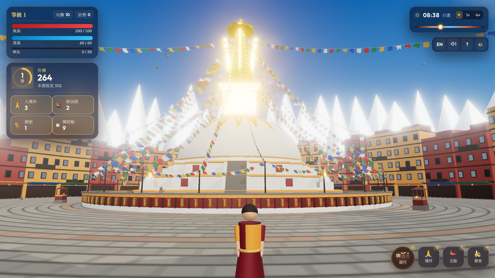
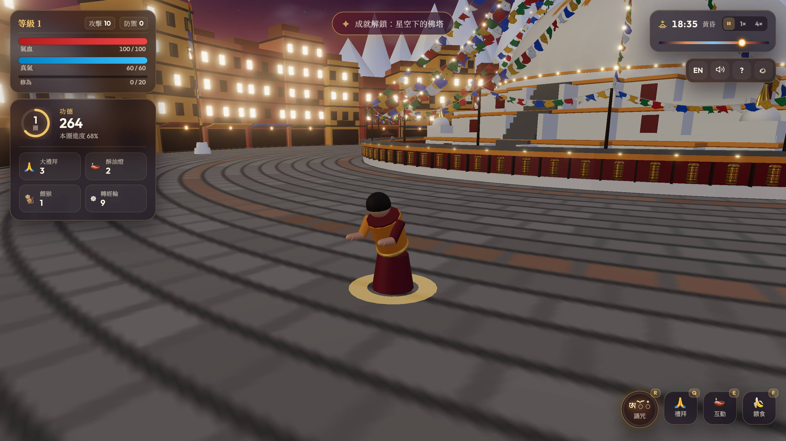
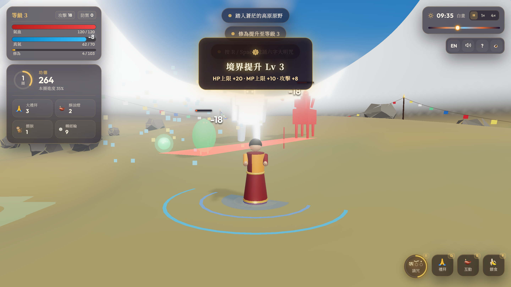

# 博達哈大佛塔・朝聖之旅 | Boudhanath Stupa Pilgrimage 3D

[](https://threejs.org/)
[](https://vitejs.dev/)
[](LICENSE)

在瀏覽器中探索 3D 喜馬拉雅朝聖世界。於加德滿都博達哈大佛塔順時針繞塔、行五體投地大禮拜、點亮酥油燈、布施獼猴；或是穿過寺院北門，踏入蒼茫神秘的高原荒野，誦念六字大明咒（唵嘛呢叭咪吽），降伏心魔與魔障，超度眾生化為五色祥光。

A serene procedural 3D pilgrimage game in the Himalayan valley of Kathmandu. Circumambulate (kora) around Boudhanath Stupa, offer full prostrations, light butter lamps, and feed mischievous macaques. Venture beyond the north monastery gate into the rugged highland wilderness to chant the Great Six-Syllable Mantra (*Om Mani Padme Hum*), dispel dark spirits, and liberate wandering beings.



## 📸 遊戲畫面 / Screenshots

| 黃昏點燈與五體投地禮拜 / Dusk Butter Lamps & Prostration | 雪域荒野與六字大明咒除障 / Highland Wilderness & Mantra Combat |
| :---: | :---: |
|  |  |
| 暮色中點亮環塔酥油燈，於佛塔前行五體投地大禮拜 | 踏入北方雪域荒野，誦念「唵嘛呢叭咪吽」綻放金蓮咒輪超度魔障 |

---

## 🎮 控制方式 / Controls

### 電腦鍵盤與滑鼠 / Desktop (Keyboard & Mouse)

| 動作 / Action | 按鍵 / Key | 說明 / Description |
|---|---|---|
| **移動 / Move** | `W / A / S / D` 或 方向鍵 | 步行探索佛塔廣場與荒野世界 |
| **奔跑 / Run** | `Shift` | 疾跑衝刺 |
| **六字大明咒 / Chant** | `R` 或 `Space` | 誦念唵嘛呢叭咪吽，綻放金色蓮花咒輪，淨化魔障與抵消法術 |
| **大禮拜 / Prostrate** | `Q` 或 `1` | 於佛塔廣場行五體投地禮拜，累積功德並回覆氣血（HP） |
| **互動・點燈 / Interact** | `E` 或 `Enter` | 點亮酥油燈、轉動經輪、穿梭山門 |
| **餵食猴子 / Feed** | `F` | 布施香蕉給獼猴，有機率獲贈神聖法器 |
| **轉動視角 / Look** | 滑鼠左鍵/右鍵拖曳 | 360 度環視場景 |
| **鏡頭縮放 / Zoom** | 滑鼠滾輪 | 縮放第三人稱視角距離 |
| **暫停時間 / Pause** | `P` | 暫停日夜光影流動 |
| **隱藏介面 / HUD** | `H` | 隱藏或顯示遊戲介面，便於沉浸截圖 |

### 手機與觸控螢幕 / Mobile & Touch

- **虛擬搖桿 / Virtual Joystick**：觸摸螢幕左半側即可呼叫搖桿控制移動，推至邊緣自動奔跑。
- **視角滑動 / Camera Pan**：在螢幕右側空白區域滑動以旋轉鏡頭。
- **人體工學按鈕群 / Action Cluster**：螢幕右下角 2×2 防誤觸動作按鈕群：
  - **誦咒（Chant）**：右下主拇指位（顯示即時冷卻光圈與藏文字母 `ཨོཾ`）。
  - **互動（Interact）**：左下位（靠近燈台、山門時發光提示）。
  - **禮拜（Bow）**：左上位。
  - **餵食（Feed）**：右上位。
- **無縫多指觸控（Multi-Touch）**：左手拖曳虛擬搖桿的同時，右手點擊動作按鈕可即時響應，互不干擾。

---

## 🏔️ 遊戲特色與荒野冒險 / Gameplay Overview

### 1. 佛塔修持 / Stupa Practices
- **繞塔（Kora）**：沿著順時針方向環繞大佛塔（塔在右肩），每繞滿一圈可累積 108 點功德。
- **大禮拜（Prostration）**：合十並全身伏地禮拜，淨化身語意，每次可恢復 25 點氣血（HP）。
- **酥油燈台（Butter Lamps）**：走近 3 座環形石雕燈台點亮酥油燈，照亮夜空並每次恢復 15 點真氣（MP）。
- **猴群布施與法器掉落（Monkeys & Sacred Artifacts）**：
  - 靠近漫步的獼猴按 `F` 投餵香蕉，每次恢復 10 點真氣。
  - 猴群有機率贈與神聖法器：
    - **加持繩（Sungdu）**：防禦力 +15（持續 120 秒）。
    - **法螺（Dungkar）**：攻擊力 ×1.5（持續 90 秒）。
    - **嘎烏盒（Gau）**：永久防禦力 +2（最高累積 +20）。
    - **金剛杵（Dorje）**：永久攻擊力 +2（最高累積 +20）。

### 2. 高原荒野與戰鬥修行 / Highland Wilderness & Combat
穿過佛塔北側的寺院山門，踏入蒼茫遼闊的喜馬拉雅高原荒野：
- **六字大明咒（Six-Syllable Mantra: ཨོཾ་མ་ཎི་པ་དྨེ་ཧཱུྃ）**：
  - 消耗 8 點真氣，以自身為中心綻放金色蓮花咒輪（半徑 6.0m）。
  - 咒輪對範圍內敵人造成攻擊力傷害。
  - **法術抵消（Dispel Magic）**：咒輪金光可瞬間擊碎敵人的遠程魔法飛行物（餓鬼鬼火、雪人冰錐咆哮），爆發為金色祥和微粒。
- **三大魔障敵人（Three Enemy Archetypes）**：
  1. **餓鬼（Preta）**：近環遊蕩，群聚出現。擅長利爪抓擊與發射追蹤綠色鬼火。
  2. **贊魔（Tsen）**：中環馳騁的紅甲騎兵。具有直線長矛衝刺突進與百步穿楊紅箭。
  3. **雪人（Migoi）**：深嶺雄踞的雪嶺巨怪。擁有撼地重擊震波、遠程拋擲巨石與咆哮冰結大地。
- **紅色預警與閃避（Telegraphs & Dodge）**：敵人在蓄力時地面會浮現清晰的紅色圓環或直線預警，看準時機閃避。
- **超度化光（Liberation VFX）**：魔障生命歸零後，不會流血死亡，而是化為藏傳五色甘露光華（藍、白、紅、綠、黃）升空超度。
- **瑪尼石堆（Mani Stone Cairns）**：荒野散落刻有六字真言的白色瑪尼堆，靠近靜立每 0.85 秒徐徐恢復 1 點真氣。
- **力竭昏厥與佛塔護佑（Faint & Recovery）**：
  - 若在原野中氣血耗盡，不會死亡；眾生祈願會將你護送回佛塔南方廣場。
  - 恢復 50% HP，扣除當前 10% 修為，並賦予 3 秒金剛不壞護體時間。

### 3. 日夜流轉與沉浸音效 / Atmosphere & Procedural Audio
- **動態天色（Dynamic Sky）**：支援真實日夜光影交替，黎明、正午、黃昏、星夜與經幡隨風飄揚。
- **全程序化 Web Audio 合成音效（Procedural Audio）**：
  - 零外部音檔，全部由 Web Audio API 即時波形調製合成。
  - 佛塔環境：西藏頌缽、銅鈴、轉經輪旋轉聲、108 Hz 溫暖「唵」字泛音共鳴墊。
  - 原野環境：高原呼嘯狂風、懸崖石壁間高亢清脆的喜馬拉雅雄鷹長唳（Eagle Cry）。
  - 穿梭山門時平滑淡入淡出（0.8 秒跨聲景交錯漸變）。

---

## 🛠️ 開發與建置 / Development

本專案完全基於標準 ES 模組與 Vite，無任何外部模型資產或重型相依套件：

```bash
# 安裝相依套件
npm install

# 啟動本地開發伺服器
npm run dev

# 專案打包建置（生成 dist/ 靜態資源）
npm run build

# 本地預覽建置成果
npm run preview
```

## 📜 架構規範 / Architecture Highlights

詳細架構設計、狀態機、事件匯流排與效能規範請參閱 [`ARCHITECTURE.md`](./ARCHITECTURE.md)。
- **零 Magic Number**：所有數值統一收斂於 `src/config.js`。
- **完全國際化**：繁體中文與英文雙語切換（`src/i18n.js`）。
- **效能預算**：保持 60 FPS，動態 PointLight $\le 6$，嚴格物件池（Object Pools）零記憶體洩漏。
