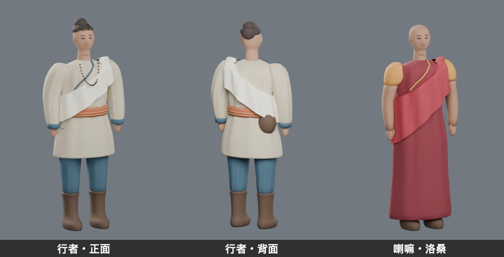
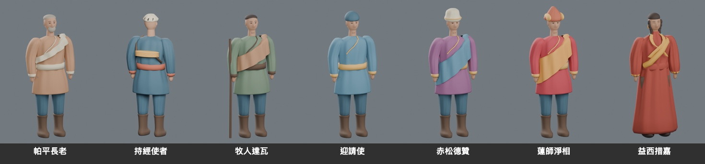

# Figures and mantra effects

## 在家行者與敘事人物

博達哈的主角是一位虛構的在家修行者。正面能看見交疊長衫、木念珠和束腰織帶，後方能辨認髮髻、白棉披肩、長褲和行囊。衣服取材於不同地區的生活服飾。尼泊爾觀光局記載的 *daura* 長衫與 *suruwal* 長褲提供上下身輪廓，不丹的 *gho* 與窄織帶 *kera* 提供收腰與衣褶的參考。尼泊爾各地、各族服飾有別。白棉披肩則借用喜馬拉雅美術中瑜伽士的衣著語彙，髮式、配色與行囊屬遊戲設計。[尼泊爾觀光局，《Cultural Treasures of Nepal》，第 53 頁](https://trade.ntb.gov.np/wp-content/uploads/2023/04/cultural-treasures-of-nepal-inside.pdf) · [不丹皇家駐印度大使館，Culture](https://www.mfa.gov.bt/rbedelhi/culture/) · [Rubin Museum，Milarepa，C2002.24.4](https://rubinmuseum.org/collection/c2002-24-4/)

洛桑、守殿老僧與寂護使用剃髮、短袖上衣、酒紅長下裳與斜披僧衣。藏傳僧團日用的 *shamtab* 下裳、*donka* 上衣及 *zen* 披衣決定大色塊與穿法。三者共用僧侶模型。[圖登卻准法師，Protocol for Sangha in the Tibetan Tradition](https://thubtenchodron.org/1996/06/cultural-differences/)



帕平長老穿便衣、蓄灰鬚，印度持經者將經函縛在背後，牧人執杖，迎請使戴布帽，赤松德贊戴纏冠。蓮師淨相採高瓣帽、長袖及披衣，既有益西措嘉則保留辮髮。這些造型讓玩家在任務啟動前就能從遠處辨認談話對象。蓮師的帽型、長袖與外披取材自 Rubin 館藏十五世紀造像。[Rubin Museum，Padmasambhava，C2005.16.36](https://rubinmuseum.org/collection/c2005-16-36/)



## 其他角色與法器

Tsogyal and the Tenma figure have braided hair, small turquoise beads, diagonal shawls and hand-modelled garment edges. The Rubin Museum’s central Tibetan painting provided references for distinguishing the peaceful and wrathful silhouettes and for the relationship between deity, textile and mount. The game’s mountain yak has a high shoulder, long flank hair, swept horns and dark hooves. [Rubin Museum, Protective Goddess in Peaceful and Wrathful Form](https://rubinmuseum.org/collection/c2012-3/)

The Samye encounter uses a white snow lion with turquoise mane and a six-armed, three-faced rider wearing a broad hat. The original mesh uses the University of Michigan Museum of Art painting as an iconographic reference. The ochre drought spirit and the shaggy Migoi use original fantasy designs. [UMMA, Pehar Gyalpo](https://umma.umich.edu/objects/pehar-gyalpo-1980-2-211/) · [Rubin Museum, Nechung monastery murals](https://rubinmuseum.org/projecthimalayanart/essays/nechung-monastery-murals/)

The ritual bell and vajra provided the starting point for a circular gold bell pulse and indigo vajra effects. The seven inputs produce a ranged seed bolt, radial chant, binding phurba, stunning bell, timed lotus shield, protector strike and guru mantra. [Metropolitan Museum of Art, Dril-Bu and Dorje](https://www.metmuseum.org/art/collection/search/502009)

## 再生與驗收

專案內已附 FBX 與三角面清單。整合後執行既有的 `Tools/tibet.py generate`，產生器會匯入所有 FBX 並校驗三角面，再執行原有 Mac 封裝流程。從 Blender 原始碼重建全部模型時依序執行 `Tools/build_figures.py` 與 `Tools/build_guardians.py`。只調整本批服飾時可單獨執行 `Tools/build_people.py`。造型圖重新匯入實際交付的 FBX，以 Blender 正背棚燈拍攝。

```sh
blender --background --python-exit-code 1 --python QA/render_people.py -- /tmp/tibet-portraits
python3 QA/test_residents.py -v
python3 QA/test_package.py play --exe "$game" --output "$journey"
python3 QA/test_residents.py --journey "$journey"
```

封裝測試從每個地區的第一步開始核對世界內可見、已註冊的角色網格與 actor ID，並檢查洛桑交談前後、供燈中途續玩、帕平使者護送至終點、青浦與博達哈回程。實玩時可在博達哈先走近洛桑按 E，再後退回望他；在帕平先找到使者，未輪到使者的步驟時無法提早交付任務。
