# 十一關遊戲畫面比較

左側為原網頁版，右側為 Unreal Engine 5.8.4 的 Mac 封裝版。每組取自同一關卡或地標，使用 55° 視角，原始解析度為 1440 × 900。遊戲版本、測試條件和測量結果見 [Mac 試玩紀錄](Mac-playtest.md)。

## 博達哈佛塔

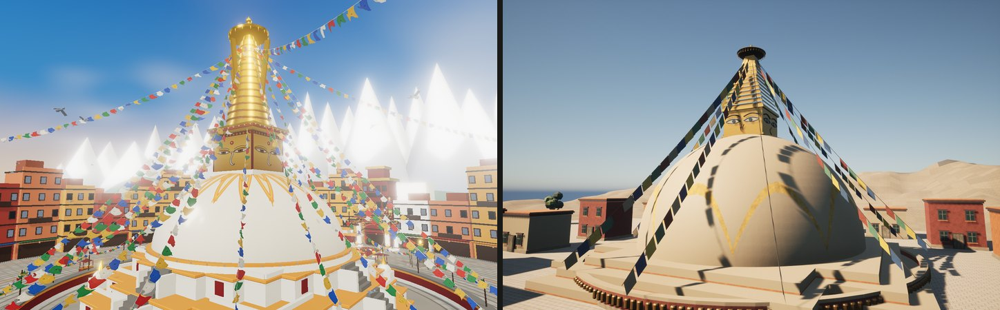

## 行者塔林

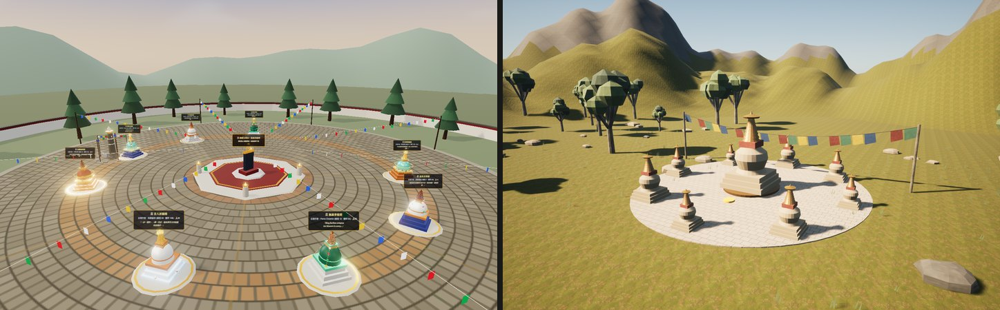

## 喜馬拉雅原野

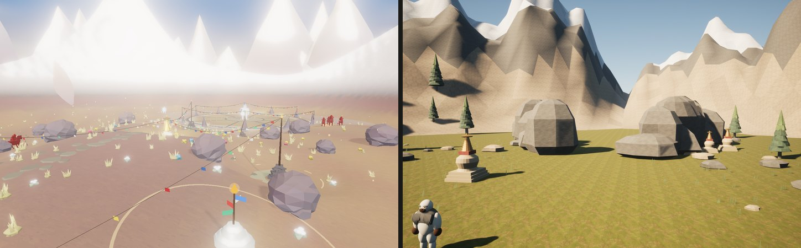

## 楊烈雪修行洞

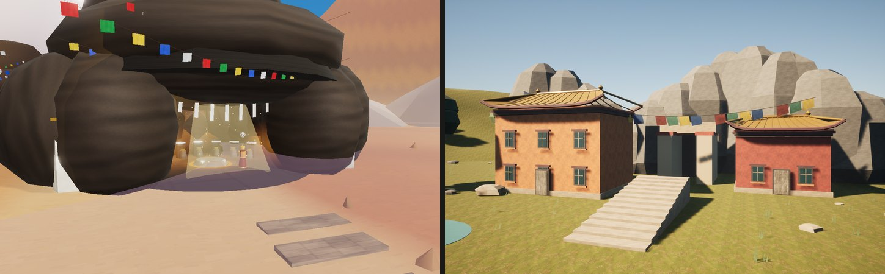

## 芒域山口

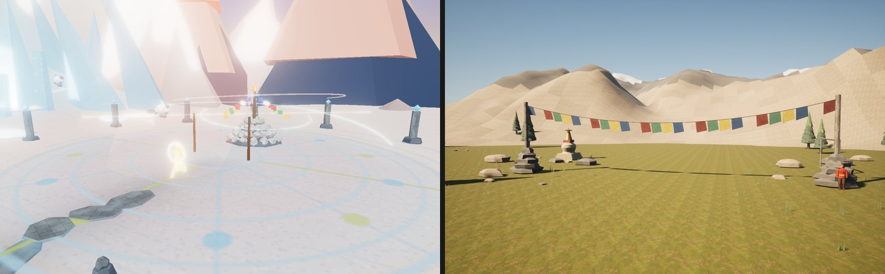

## 雅隆雍布拉康

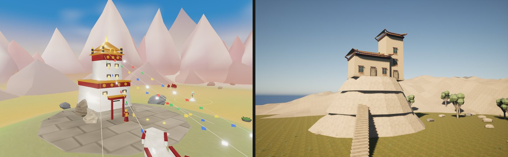

## 桑耶寺烏孜大殿

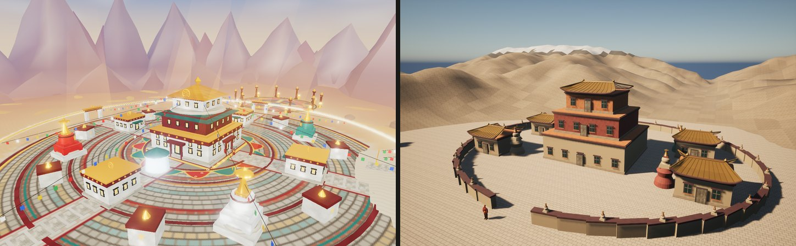

## 青樸石窟

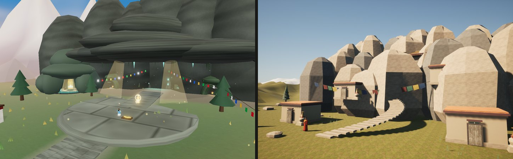

## 伏藏第一層

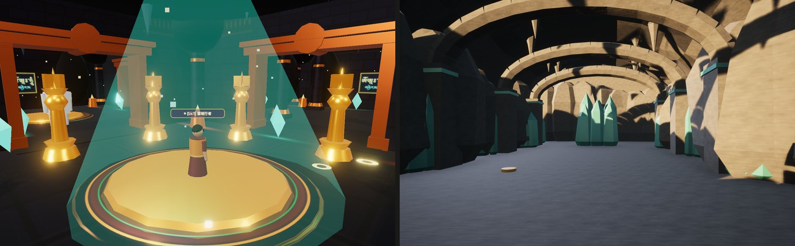

## 伏藏第二層

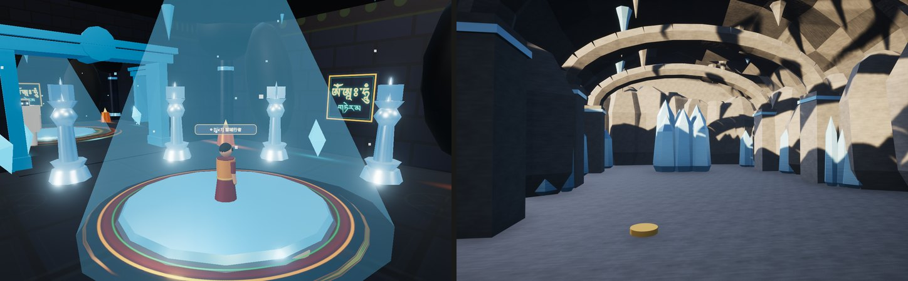

## 伏藏第三層

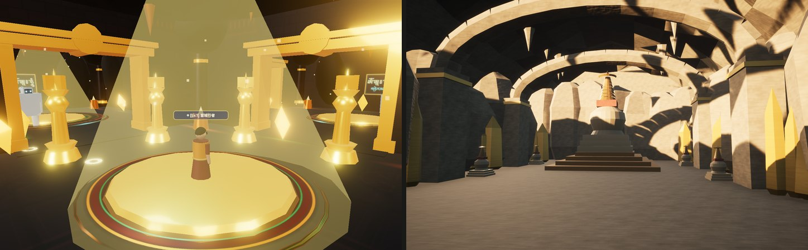
