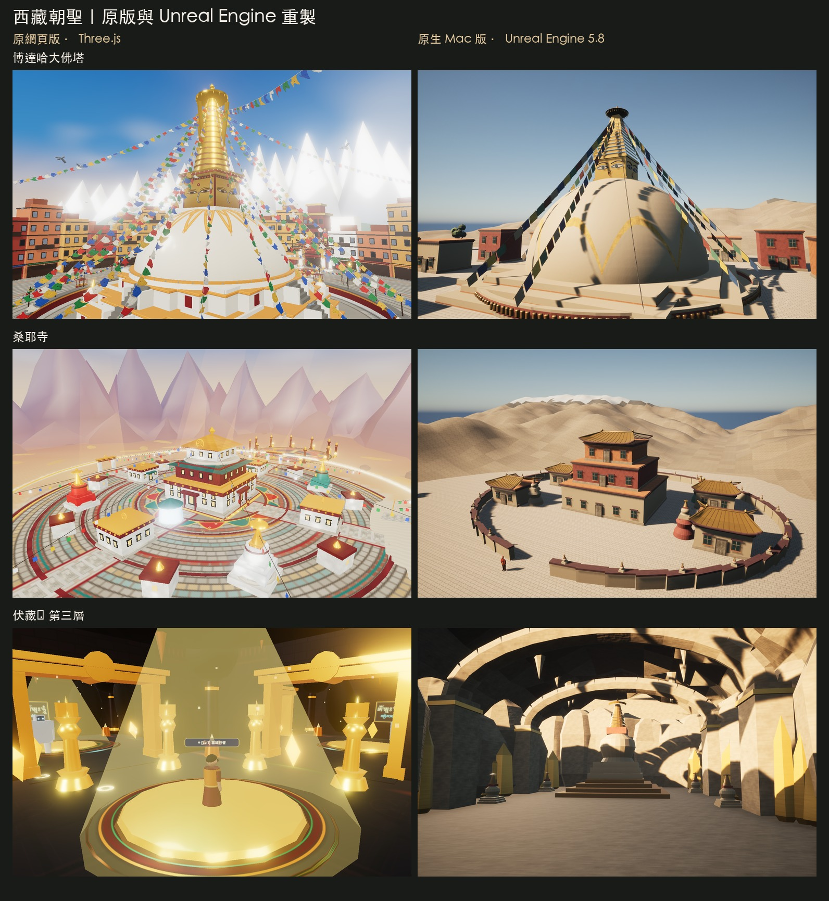
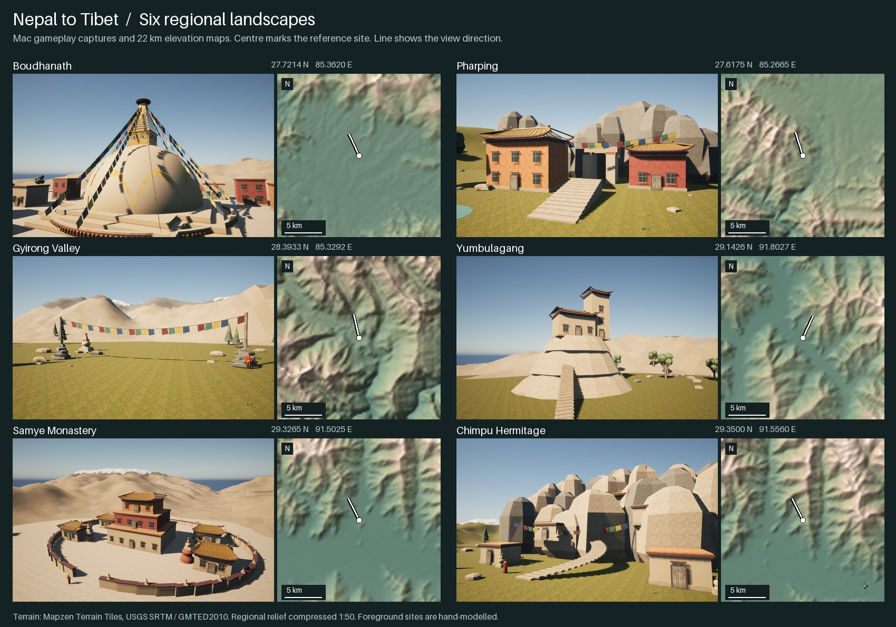

# Mac 封裝版試玩紀錄

2026 年 11 月 20 日在 Apple M3 Pro、18 GB、macOS 26.4.1 測試 Unreal 5.8.4 的 arm64 Development 封裝，版本為 `58902052.0.5`。網頁版基準為 `9532be5`。攝影和遊玩程序、座標及按鍵記錄方式見 [試玩說明](../README.md)。

| 驗收 | 觀察結果 |
| --- | --- |
| 主線與結局 | 從新存檔開始，與洛桑交談後重啟讀回第一個任務進度。走過北郊、帕平、芒域、雅礱、桑耶與青樸，完成三層伏藏，返回青樸及博達哈觸發結局。主線保存 69 張 HUD 截圖。 |
| 行者塔林 | 從博達哈南門進入，完成裝藏並返回大塔。 |
| 七種招式 | 第三層守藏者遭遇中依序輸入七個按鍵，記錄均有對應施法事件。蓮盾觸發時持續時間為 6 秒。 |
| 移動與碰撞 | Editor 檢查十一個場景的 269 個目標點及 64 段膠囊體移動路徑，全部通過。 |
| 視角與效能 | 11 組 1440 × 900 原圖逐一核對 SHA-256。每處取 60 個靜態攝影幀，M3 Pro 各處第 95 百分位幀間隔介於 11.67 與 15.62 毫秒。戰鬥與手機效能須另行測量。 |
| 啟動 | 透過與 Finder 相同的 LaunchServices 啟動 12 次，全部完成渲染並正常退出。密集從終端直接啟動 bundle 裡的執行檔時，兩次在遊戲日誌建立前於 Unreal 記憶體追蹤器及 AppKit 啟動呼叫堆疊中崩潰，兩次重試均成功。 |

六處實景各取 22 公里見方的高程圖，北向朝上。白線表示遊戲鏡頭方向。遊戲中遠景等比縮為 1/50，建築前景以可行走距離重新配置。[測量與座標](../../Assets/Relief/README.md)

