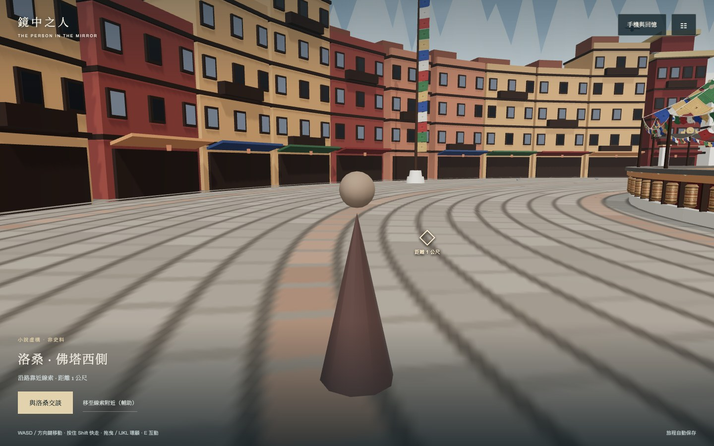
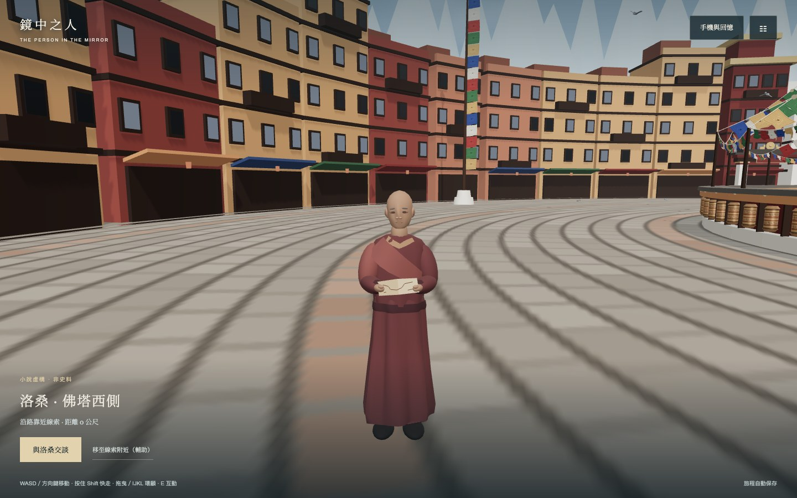
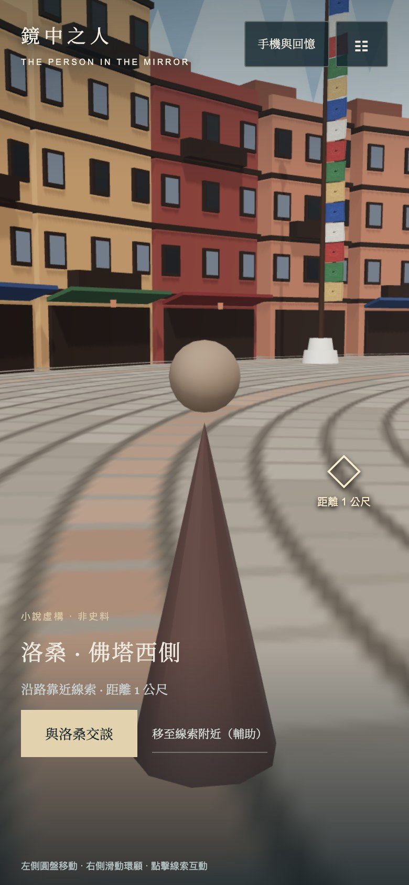
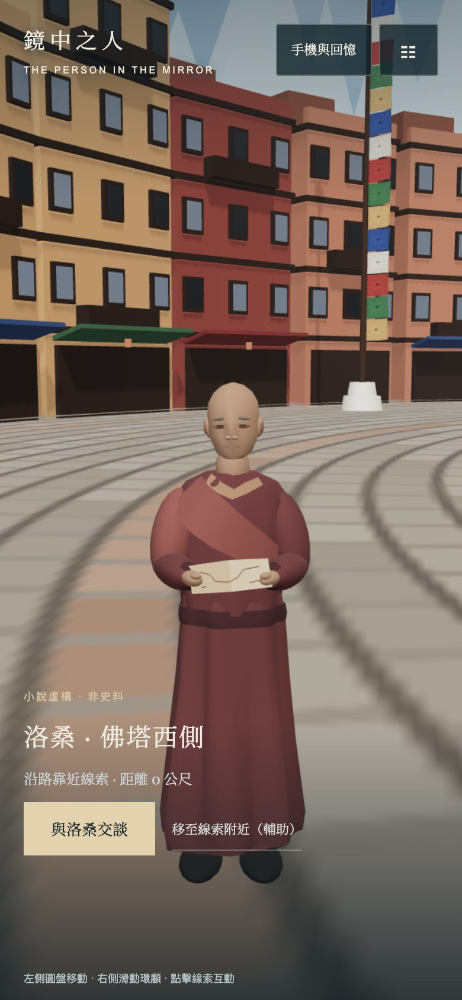

# Losang visual follow-up — #90

Baseline: PR #80, `1a817fe`. Native GPT-6.1 Sol worker authored the original procedural model (`d156632`); lead reviewed the source, integrated only narrative runtime, independently ran validation and inspected actual in-game desktop/mobile images.

## Change and provenance

The previous cone/sphere placeholder is replaced by a 1.63 m adult character with layered robes, arms/hands, shoes, restrained face detail and folded paper. The paper contains only abstract linework, no invented script. Novel chapter 2 identifies Losang as an elderly lama; #84's former repair-worker description was corrected against the current novel. These face/costume choices remain provisional, not author-approved final art. The visual quality is stylized procedural 3D, not photoreal character animation.

The accessible guide now faces him from ~3 m instead of facing the stupa. A 0.35 m collision circle prevents overlap. Runtime suppresses breathing with reduced motion and disposes owned resources on non-bfcache pagehide. No combat, adventure NPC, save schema, phone dialogue or six-step map handoff was changed.

## Independent validation (2026-11-06)

- `npm run build`, `npm run check:i18n`: PASS (2,190 keys per language).
- `npm test`: 40 PASS. Expected corrupt-save fixture diagnostics are not test failures.
- Full native Chrome browser suite: 14 scenarios PASS, 0 uncaught errors; both complete desktop/phone journeys, 9 checkpoint resumes, missing-media fallback, adventure bootstrap/equipment/map smoke checks. 12 art preset/lighting/quality samples also passed. See [report](evidence/losang/regression-report.json).
- Targeted actual-world checks: 1440×900 DPR1 desktop and 390×844 DPR2 touch, before/after at the same camera pose, daylight/dusk; guide orientation, desktop walk collision, 6 dialogue lines, Escape/reopen, map handoff/reload, and unrelated inventory/quest sentinel preservation PASS. See [targeted report](evidence/losang/report.json).
- At sampled dusk views: desktop calls 80 → 116, triangles 225,592 → 235,298; mobile 64 → 100, triangles 161,256 → 170,962. PointLights stay 0. Different viewport draw counts are visibility/culling dependent. These measurements are not low-end phone FPS acceptance.
- Existing adventure browser check does not assert its recorded Hum Bolt result and checks co-op API presence only. #92 tracks stronger actual combat/waypoint/multiplayer tests; this report does not claim remote multiplayer was exercised.
- Independent Sol source review caught a collider that stayed active while Losang was invisible. Runtime now registers/removes that collider with visibility. After this final correction, build/i18n and both targeted desktop/mobile scenarios passed again, explicitly checking early exploration has no invisible collider and the Losang beat restores it. See [final recheck](evidence/losang/recheck-report.json). The full 14-scenario run above preceded this narrow correction; the final diff has these targeted rechecks.

Targeted reproduction (baseline server optional):

```sh
STORY_BASE_URL=http://127.0.0.1:4175 LOSANG_BASELINE_URL=http://127.0.0.1:4174 BROWSER_CHANNEL=chrome node scripts/losang-browser-test.mjs
```

## Captured in-game frames

| Baseline | New provisional character |
|---|---|
|  |  |
|  |  |

Day/dusk variants and dialogue frames are in the same evidence directory. Final character likeness/costume approval remains in #84; screenshots make that decision reviewable. This PR is a separate candidate based on #80 and has not been merged into #80 or master.
