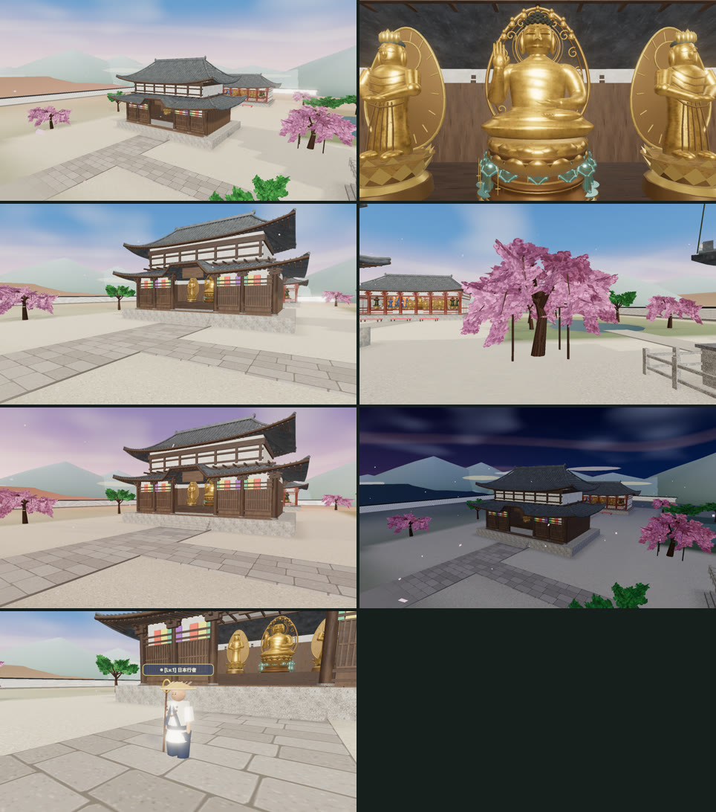

# 東寺金堂試玩與畫質比較記錄

2026-11-20。網頁版已完成操作試玩與七個固定鏡位拍攝。UE 原生版的包裝、操作試玩、實際畫面與幀時間尚待 Mac 引擎環境就緒。這一版報告只記載目前量到的結果。

上圖由左至右、由上至下對應下列七個鏡位。主尊近看可辨手印和衣褶，但兩側佛像的幾何更簡化。前庭的石板看得出接縫，輪廓與磨損程度則變化有限。櫻花外緣可見重複的平面花簇，行者衣袍仍有圓柱狀輪廓。夜景可辨建物，但地面和殿內的亮度差距小。這些是原生版回拍後要逐項比較的地方。

| 鏡位 | 網頁幀間隔 p95 | 網頁 GPU 時間 p95 |
| --- | ---: | ---: |
| 金堂外觀 | 17.6 ms | 11.90 ms |
| 主尊近景 | 17.7 ms | 12.95 ms |
| 前庭石階 | 17.8 ms | 13.62 ms |
| 櫻花樹 | 17.7 ms | 11.33 ms |
| 薄暮前庭 | 17.9 ms | 11.82 ms |
| 夜間金堂 | 18.1 ms | 11.10 ms |
| 行者 | 17.7 ms | 12.96 ms |

**測試條件。** 網頁遊戲版本 `9532be515808c87f11ddb01c77ae348fee01e79d`。MacBook Pro、M3 Pro、18 GB，macOS 26.4.1，Chrome 157，以 ANGLE Metal 使用硬體 GPU。桌面版使用 1920 × 1080、DPR 1、春季、垂直視角 55°，開啟陰影和 bloom。每個相機暖機 45 幀後量測 90 幀。此輪同機有開發活動，且瀏覽器會跟隨螢幕更新節奏。跨引擎幀率之差及長時間負載皆待獨立重測。

**遊玩觀察。** Playwright 使用鍵鼠和觸控輸入走完日本篇 30 個依序目標，含東寺全部六項。覆蓋對話、供燈、三次結界試煉、離開與再次進入日本篇、舊存檔相容、建物碰撞及橋梁通行，輸出 15 張遊玩截圖，未記錄瀏覽器執行錯誤。測試以定位縮短長距離通勤，最終接近與任務互動經由遊戲控制。七個畫質鏡位另以固定相機拍攝。

原生端需以同機打包版進場試玩、重新啟動後核對存檔，再拍攝同鏡位。記錄畫面時持續區分角色與植被的形狀、材質質感、光照和建築辨識度；連續遊玩時另記錄卡頓與動態光照穩定性。UE 差異、效能及寫實程度均以取得的實際遊戲畫面判定。參見[比較工具與重現方式](../Unreal/QA/README.md)與[原生遊玩步驟](../Unreal/StupaPilgrimage/Tests/Gameplay.md)。
