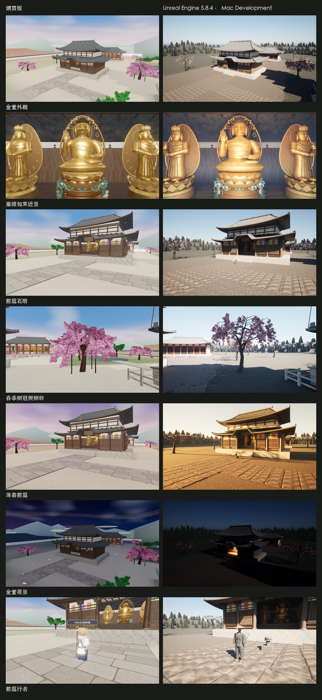

# 東寺金堂在 Mac 上的實際畫質與試玩結果

**Unreal Engine 可以把東寺做成可獨立啟動的原生遊戲。** 相同鏡位下，最明顯的改善在屋簷的投影、傍晚木構的明暗，以及行者的斗笠和衣褶。原有的金堂與佛像仍看得出簡化造型，遠山的樹形和大面積地表也容易看出重複。目前適合繼續製作這個可玩樣板，距離 3A 寫實畫面與穩定 1080p 60 FPS 都還有差距。

## 七個相同鏡位

左欄是 Chrome 實際執行的網頁版，右欄是獨立啟動的 UE Mac 打包版。每列使用同一套相機位置與朝向、1920 × 1080、55° 垂直視角及對應的春季日照時段。兩個引擎各自計算曝光與光照。點選圖片可看大圖。

| 鏡位 | 畫面觀察 | 網頁 p95 | UE 中位幀時間 | UE p95 |
| --- | --- | ---: | ---: | ---: |
| 金堂外觀 | UE 能看見挑簷在木柱和地面留下的陰影，遠處山脊仍有重複的樹形。 | 17.60 ms | 32.17 ms | 33.75 ms |
| 藥師如來近景 | UE 的金箔與殿內暖光更顯眼，胸前高光仍遮掉部分表面細節，側像衣褶和蓮座輪廓沿用原模型。 | 17.70 ms | 35.88 ms | 36.87 ms |
| 前庭石階 | 網頁版的石板近似等寬網格，UE 版可分辨板緣和表面起伏，遠處大塊地表仍偏均勻。 | 17.80 ms | 32.81 ms | 34.23 ms |
| 春季櫻樹 | 網頁版是連續的粉色花冠，UE 版可辨樹幹、枝間空隙及細花簇。實拍後已調整樹高，完整樹冠可放進同一畫面。 | 17.70 ms | 33.05 ms | 33.87 ms |
| 薄暮前庭 | 低角度暖光穿過木構，石路上能看到樹枝的長影。 | 17.90 ms | 33.36 ms | 34.18 ms |
| 金堂夜景 | 校正後的月光保留深藍天色、屋頂和石基輪廓，殿內暖光聚在佛壇。前庭背光處仍偏暗。 | 18.10 ms | 31.58 ms | 32.29 ms |
| 前庭行者 | UE 版的斗笠、斜背帶及垂落衣袍可分辨，臉部細節受帽簷陰影限制。 | 17.70 ms | 34.28 ms | 35.15 ms |

固定鏡位各量 90 幀。p95 表示 95% 的幀間隔不超過表列時間。網頁基準會跟隨螢幕更新節奏，擷取時同機尚有開發活動，兩欄的差值無法單獨歸因於引擎。UE 使用 TSR、100% 內部解析度、停用動態解析度與 VSync，陰影與全域光照均為 Epic（3）。測試機為 M3 Pro、18 GB 統一記憶體、macOS 26.4.1，UE 為 5.8.4 Development，網頁為 Chrome 157、ANGLE Metal，原始碼基準為 `9532be5`。[逐幀資料、畫面雜湊與相機設定](benchmarks/toji-mac-cameras.json)

同一個金堂外觀鏡位另試了 **66.67% 內部解析度**，約 1280 × 720，再以 TSR 輸出 1920 × 1080。UE 中位幀時間從 32.17 降到 22.96 ms，p95 從 33.75 降到 24.30 ms。這個鏡位已有改善，距離 60 FPS 的 16.67 ms 幀預算仍有差距。

## 遊戲與存檔

UE 測試從南側起點進場，以遊戲的鍵鼠輸入移動和轉向，實際完成空海對話、供燈、曼荼羅，以及地、火、風三次各需兩次施法的試煉。過程涵蓋跳躍、切換日照與繁中 HUD。從獨立存檔重新啟動後，六項完成紀錄和中文設定均保留。影片擷取的是實際遊戲視窗，移動時每秒約四張，再依時間戳編成無聲影片。影片幀數不作效能量測。

另一組獨立測試把現有網頁版 v2 存檔帶進原生遊戲。UE 正確還原前兩個東寺目標及繁中設定，原始 JSON 的備份逐位元相同。測試重新啟動並嘗試匯入較新的未知版本後，既有進度及原始備份仍保留。UE 自動化測試 `Stupa.Toji.Save.WebV2` 通過。網頁基準另以桌面及觸控輸入走完日本篇 30 個目標，涵蓋東寺六項，取得 15 張遊玩截圖，未記錄到瀏覽器執行錯誤。[原生互動步驟與相容性案例](../Unreal/StupaPilgrimage/Tests/Gameplay.md)

## 連續遊玩效能

15 分鐘固定路徑量測已啟動，這一版先記錄已驗證的固定鏡位和遊玩結果。
