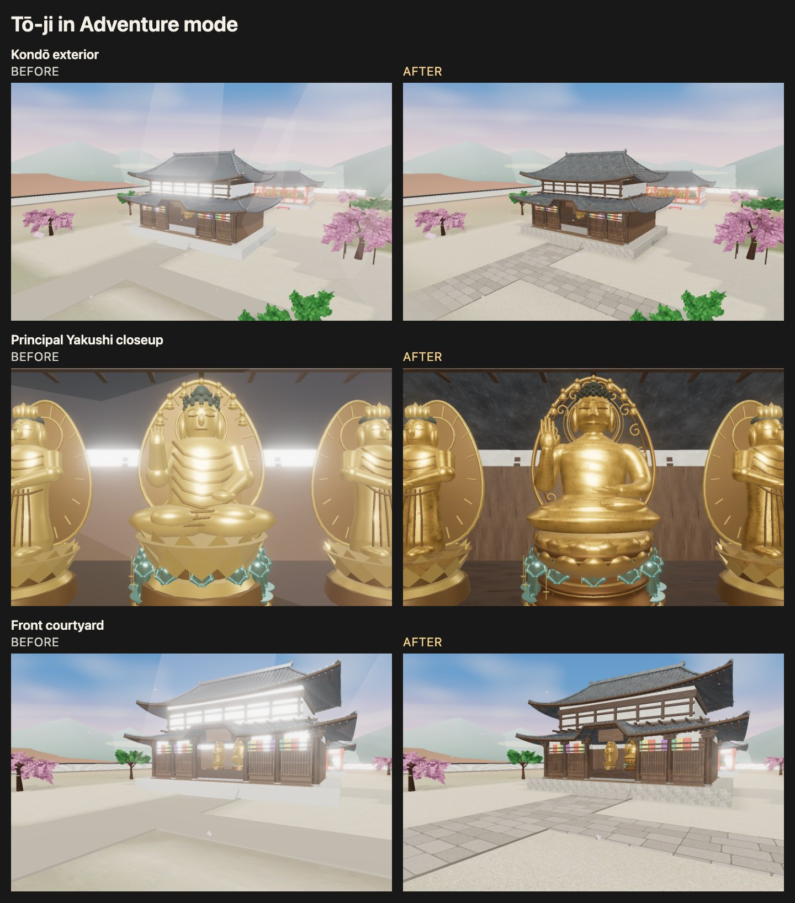

# Tō-ji Kondō quality reference (#301)



The reference scene is Kondō, its principal Yakushi image, and the entrance
forecourt. It builds on #290 without changing the other three landmark GLBs,
building placement, navigation, interaction, save data, or the light budget.
The result retains the game's stylized proportions; it is an original authored
interpretation, not a scan or a claim of photographic/AAA equivalence.

## Art and rendering

- Kondō timber, smoked tiles, granite, lime plaster and gilt use original
  deterministic base-color, roughness/metalness/occlusion and normal maps.
  Physical-scale UV projection aligns wood grain with the beam/column direction.
- The principal Yakushi has continuous face, torso and lap surfaces, curved
  arms, separate tapered fingers, convex lotus petals and an openwork aureole.
  The pose keeps the raised right hand, empty upturned left hand and seven
  miniature Buddhas. The remaining figures keep their previous geometry.
- High-resolution facial/cloth surfaces bake into a 512px tangent normal map.
  A separate 512px short-radius AO bake captures local creases, with strength
  0.65 to retain dark-room detail. Both use `SculptureUV` / glTF `TEXCOORD_1`;
  shared gilt maps use `UVMap` / `TEXCOORD_0`. High sculpt objects are removed
  before export. The principal gilt has no emissive fill.
- The existing forecourt/paving materials receive localized 256px gravel and
  staggered stone textures. Soft contact shading anchors the podium and steps.
  The hall modulates existing direct/ambient/reflected light with the shared
  day/night uniform. This is a bounded artistic approximation, not a new GI
  renderer or a baked directional-sun solution.
- Translucent beam cones that crossed the roofs have been removed from Tō-ji.
  Seasonal trees, petals, sky, fog and the existing lighting remain active.

The statue and architectural references are the photographs linked in
[the Japan art provenance document](japan-temple-art.md). No reference photograph
is shipped as a texture. Surface recipes are described in
[the material authoring notes](toji-kondo-materials.md).

## Mobile and asset budgets

The existing mobile path continues to omit the desktop shadow and bloom passes
and caps render DPR at 1.25. This reference adds no PointLights, real-time bake,
post-processing pass, or per-frame texture allocation. Solid architectural
materials and the closed hero surface use backface culling.
Mobile/low-spec also omits architectural normal maps while keeping base color,
roughness/metalness, AO, and the principal statue's baked normal map. This avoids
uploading the small-scale wood/tile/stone/plaster normal textures and removes
their fragment-shader work. The embedded GLB download is shared across profiles;
this tier reduces GPU use rather than download bytes.

| Kondō GLB | Before (#297) | Quality reference |
| --- | ---: | ---: |
| Triangles, one geometry pass | 54,756 | 76,318 |
| Material primitives | 16 | 21 |
| Download bytes | 1,812,060 | 4,637,828 |
| Embedded images | 0 | 19 |
| Largest texture edge | — | 512 px |
| RGBA8 texture estimate including mips | 0 | 11.0833 MiB |

The two 256px courtyard textures add about 0.667 MiB including mipmaps. They
share existing geometry/draws and are included in the capture's material-memory
accounting. The automated asset guard caps Kondō at 78,000 triangles, 21 material
primitives, 5,000,000 download bytes and 12 MiB embedded RGBA8+mips. The original
budgets for Kōdō, the pagoda and Daitō remain unchanged. Increasing visible
detail has a real cost; reduced first-candidate geometry does not imply the new
asset is cheaper than the old one.

## Reproduce the asset

Authored through the same dedicated Blender MCP 2.2.7 / addon protocol 15 /
Blender 5.2.3 LTS workflow recorded for #290. The source can also run headlessly:

```sh
/Applications/Blender.app/Contents/MacOS/Blender --background --factory-startup \
  --python scripts/blender/build_japan_temple_art.py -- --assets kondo \
  --output /tmp/toji-rebuild/models --source /tmp/toji-rebuild/source
```

The source creates all maps, bakes normal/AO, saves an editable `.blend` if
requested, batches meshes by material, and exports embedded glTF textures.
Bakes are retained under ignored `artifacts/toji-quality/bakes`. A clean-process
rebuild was compared with the MCP export and produced the same SHA-256:
`8115ac6ea72f8be302755e6765d2f9a62700c8dafea46141b1c517b67310978f`.

## Matched comparison

Use a frozen production build for each revision, with separate preview ports;
multiple Vite dev servers sharing `node_modules/.vite` can invalidate each
other's dependency cache and reload during capture. The harness uses the real
game animation/render pipeline, including desktop post-processing and the
actual mobile quality path. It captures exterior, Yakushi, courtyard, and night
views, with identical cameras, 55° FOV, spring season, time and profile settings.

```sh
STORY_BASE_URL=http://127.0.0.1:4195 TOJI_QUALITY_SOURCE=e6d4a33 \
  TOJI_QUALITY_LABEL=before BROWSER_CHANNEL=chrome \
  node scripts/toji-quality-browser-test.mjs
STORY_BASE_URL=http://127.0.0.1:4211 TOJI_QUALITY_SOURCE=<served-revision> \
  TOJI_QUALITY_LABEL=after BROWSER_CHANNEL=chrome \
  node scripts/toji-quality-browser-test.mjs
node scripts/toji-quality-browser-test.mjs --compare
```

Output defaults to ignored `artifacts/toji-quality`; override with
`TOJI_QUALITY_OUTPUT`. Each run records the served model SHA-256, GPU/browser,
render configuration, 45 warmup frames and 90 samples per view. GPU timer
queries discard disjoint samples; frame intervals also include browser pacing.
Texture estimates deduplicate actual uploaded allocations and include custom
shader textures, but exclude render targets, cube maps, driver overhead and
hidden maps. Paired HTML/JSON reports keep these limits beside the measurements.

Both profiles run on one desktop machine. Mobile emulation verifies the mobile
rendering path and relative resource changes; it is not a physical-phone FPS or
thermal/battery measurement. Real device testing remains necessary before
claiming a particular handset's sustained frame rate.

The final production comparison ran in Chrome 157 on an Apple M3 Pro. Mobile
emulation's daytime frame-interval p95 remained around 18 ms; its GPU p95 rose
from 2.43/2.64/1.62 ms to 3.46/3.95/3.55 ms for exterior/hero/courtyard. These
short samples document the extra rendering work, not an FPS promise. Estimated
uploaded material textures grew from 0.92 MiB to 10.58 MiB on mobile and 12.67
MiB on desktop. The mobile normal-map tier saves four uploaded textures and
2.08 MiB versus the full new material set; repeated samples did not demonstrate
a consistent GPU-time improvement from that tier alone. Both profiles passed
all four day/night views with no browser errors or active PointLights.
